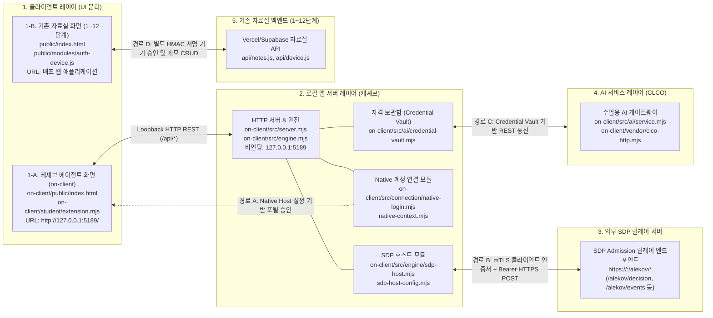

# BYTE BACK 방어전 시작 틀 R5

이 저장소는 1단계에서 학생 본인이 GitHub 저장소와 Vercel 배포를 만드는 출발점입니다. 실제 학생 자료, 토큰, 비밀키를 넣지 마세요.

## 학생이 하는 일: 세 걸음

1. GitHub 계정을 만듭니다.
2. 방어전 1단계 카드의 **Deploy** 버튼을 누릅니다. Vercel에 GitHub로 로그인하고, 새 저장소가 **본인 계정의 Public 저장소**인지 확인한 뒤 Deploy를 누릅니다.
3. 배포가 끝나면 화면에 나온 `https://…vercel.app` 주소를 방어전 1단계 카드에 붙여넣고 제출합니다. 저장소 주소나 설정 파일은 적지 않습니다.

배포가 끝나면 `/`에서 점령된 자료실을 볼 수 있습니다. 이 공개 상태를 확인하는 것이 1단계의 출발점입니다. 1단계 접수와 심판 판정은 포털에서 확인합니다.

## 시작 틀의 자동 처리

`vercel.json`은 정적 결과물 `public`을 배포합니다. 빌드 명령 `npm run build`는 Vercel이 제공하는 GitHub 저장소 소유자·이름, 커밋 SHA, 배포 URL을 검증하고 `public/aleph.json`을 생성합니다. 이 값이 없으면 빌드가 실패하므로, 성공한 것처럼 빈 주소를 내보내지 않습니다. `aleph.json`의 내용만으로 저장소 소유권이나 방어 성공을 인정하지 않습니다. 심판이 공개 저장소의 실제 커밋과 배포된 자료를 따로 대조해야 합니다.

`aleph.config.json`의 `repoUrl`과 `publicAppUrl`은 이전 제출 묶음 방식의 자리표시자입니다. 1단계에서는 학생이 편집하지 않습니다. 2단계 이후 코딩 도구가 필요한 설정과 보호 기능을 단계별로 작성합니다. `npm run bundle`과 `bundle-notes.json`도 1단계의 세 걸음에는 포함되지 않습니다.

로컬에서 화면만 확인할 때는 `npm run build -- --local`을 사용합니다. 로컬 실행은 Vercel 배포나 심판 접수를 증명하지 않습니다.

---

## 8단계 구역 분리 및 인가 규칙

- **구현 내용**:
  - 자료실 메모(`note:<id>`)와 강사 공지(`notice:<id>`)를 자원 ID 단위로 구분.
  - ZTNA 판정기(`src/decider.mjs`)에 구역 규칙(`zone_rule`)을 적용해 타인 메모 접근, 공지 임의 수정, 비인가 경로 및 쿼리 요청 차단(`zone_violation`).
  - API 라우트(`api/notes.js`, `api/notices.js`)에서 인증 사용자 신원과 데이터베이스 소유자·역할을 대조해 위조 및 교차 접근을 `403`으로 차단.
  - XDR(01~06) 비정상 공격 탐지 및 차단 로직 연동.
- **실행 및 검증**:
  - `node scripts/fixture-7.mjs` (정상 접속 및 복합 이상 접속 Step-up 판정 비교)
  - `node scripts/decider-test.mjs` (판정기 규칙 3건 종합 검증)
  - `node scripts/xdr-run.mjs <moduleKey>` (XDR 탐지·차단 연동 확인)

## 9단계 이상 탐지 규칙

- **구현 내용**:
  - `src/detect.mjs`의 `detect(events)`가 사건 스트림의 `at`, `method`, `identity.sub`를 분석.
  - 10분 구간 내 단일 사용자의 `GET` 요청이 120건을 초과하면 `{ action: 'propose_revocation', reasonCode: 'burst_read' }` 반환, 그 외에는 `{ action: 'observe' }` 유지.
  - 판정기(`src/decider.mjs`)의 인가 응답은 그대로 유지하며, 사건 계약에 없는 속성은 참조하지 않음.
- **실행 및 검증**:
  - `npm run detect:test` (가상 사건 6건 단위 테스트)

## 10단계 메모 및 정책 복원

- **메모 단건 복원**:
  - 경로: `POST /api/restore`
  - 요청 본문: `{ "id": "<메모 ID>", "contentHash": "<sha256 64자리>", "dryRun": true|false }`
  - 비공개 사본(`notes_backup`)과 ID·소유자·내용 해시가 모두 일치할 때만 복원 실행.
  - `"dryRun": true` 요청 시 실제 DB 변경 없이 복원 대상 버전과 변경 필드 미리보기 반환.
  - 복원 쓰기 후 사후 검증 불일치 시 직전 상태로 자동 롤백 및 `409` 반환.
- **시험 정책 복원**:
  - 명령: `npm run policy:restore -- <커밋 SHA> [--apply --confirm <SHA 앞 12자리>]`
  - 안전 커밋을 기준으로 `aleph.config.json`의 시험 정책(`allowedRoutes`, `protectedService`, `originalApiUrl`, `restoreRoute`, `identityProvider`)만 롤백.
  - `--apply --confirm` 없이 실행 시 변경 사항 미리보기만 출력.
- **실행 및 검증**:
  - `npm run test:restore` (메모 복원 로직 9건 검증)
  - `npm run test:policy-restore` (정책 복원 안전 규칙 6건 검증)

## 11단계 접속 앱 및 기기 승인

- **구현 내용**:
  - PWA 매니페스트(`public/manifest.json`), 앱 아이콘, 오프라인 감지 배너 구성.
  - 클라이언트 스크립트를 `public/modules/` ES 모듈(`dom.js`, `api-client.js`, `auth-device.js`, `vault-ui.js`, `ops-room.js`, `pwa-network.js`)로 구조화.
  - 기기 승인 엔드포인트(`api/device.js`)에서 HMAC-SHA256 승인 토큰 발급.
  - 자료 API에서 기기 승인 토큰을 검증해 미승인 기기 접근을 `403 DEVICE_NOT_APPROVED`로 차단.
  - 브라우저 저장소(`localStorage`/`sessionStorage`)를 배제하고 메모리 변수와 쿠키로만 세션 관리.
- **실행 및 검증**:
  - `node --test test/device.test.mjs` (기기 승인 토큰 발급 및 접근 차단 3건 통과)
  - `node scripts/build-public.mjs --local` (정적 빌드 검증)

---

## 12단계 탈환 작전실 운영 요약

기준 커밋: `98e8b29`

ALEPH SDP 엔진의 요청·사건 전달 계약을 바탕으로 판정기, 이상 탐지, 접속 앱, 보호 자료실을 연동해 운영합니다.

### 1. 제공 엔진과 학생 구현 몫

| 구성 요소 | 제공 엔진 역할 | 학생 구현 몫 |
|---|---|---|
| **판정기** | 사전 신원·기기·경로 검증, 릴레이, `aleph.decision.v1` 전달 | `src/decider.mjs` 3대 규칙 (`device_registered`, `step_up_required`, `zone_rule`) |
| **탐지 규칙** | 가상 사건 스트림 생성 및 전달 | `src/detect.mjs` 10분 내 120건 초과 `burst_read` 감지 및 회수 제안 |
| **접속 앱** | 브라우저 PWA 런타임 및 오프라인 서비스 지원 | PWA 메타데이터, 저장소 배제 메모리 세션, 작전실 대시보드 (`public/`) |
| **자료실** | Vercel 인프라 & Supabase 릴레이 | 자료 및 기기 승인 API(`api/`), 메모 단건 복원 및 정책 복원 도구 |

> **비밀값 취급 원칙**: DB 접속 정보, 서비스 키, 사용자 비밀번호, 세션 토큰은 소스코드나 문서에 기록하지 않고 환경변수(`SUPABASE_URL`, `SUPABASE_SECRET_KEY`)로 주입합니다.

### 2. 4대 구성요소별 실행 및 관리

1. **학생 판정기 (`src/decider.mjs`)**
   - 규칙 검증: `node scripts/decider-test.mjs`
   - Step-up 비교: `node scripts/fixture-7.mjs`
   - 비인가·타 구역 요청 차단: `deny` 또는 `step_up` 반환
2. **탐지 규칙 (`src/detect.mjs`)**
   - 탐지 검증: `npm run detect:test`
   - 임계치 초과(10분 120건 초과): `propose_revocation` 제안 반환 (120건 이하는 `observe`)
3. **접속 앱 (`public/`)**
   - 브라우저 접속 또는 PWA 앱 설치
   - 로그인 후 [기기 승인 요청]으로 서버 확인 통과 시에만 보호 자료실 열람
   - 상단 작전실 대시보드 및 [🚀 1~11단계 실측 검증 실행]으로 실측 상태 확인
   - [로그아웃] 클릭 시 쿠키 만료 및 메모리 세션 초기화
4. **보호 자료실 (`api/`)**
   - 로컬 실행: `npx vercel dev` (포트 3000)
   - 정적 빌드: `node scripts/build-public.mjs --local`
   - 메모 단건 복원: `POST /api/restore` (사본 해시 검증 및 dryRun 지원)
   - 정책 복원: `npm run policy:restore -- <커밋 SHA>`

### 3. 전체 시스템 검증 순서

1. **의존성 설치**: `npm install`
2. **환경변수 확인**: `.env.local` 또는 Vercel 대시보드에 `SUPABASE_URL`, `SUPABASE_SECRET_KEY` 설정
3. **로컬 단위 테스트 실행**:
   - `node scripts/decider-test.mjs` (판정기 규칙 3건 통과)
   - `npm run detect:test` (탐지 규칙 가상 사건 통과)
   - `node --test test/device.test.mjs` (기기 승인 토큰 발급 및 차단)
   - `npm run test:restore` (메모 복원 로직)
   - `npm run test:policy-restore` (정책 복원 안전 절차)
4. **정적 빌드 검증**: `node scripts/build-public.mjs --local`
5. **작전실 실측**: 브라우저 접속 후 [🚀 1~11단계 실측 검증 실행] 클릭하여 5건 실측 및 36건 미실행 상태 확인

---

## 복구 뒤 1~11단계 다시 확인하는 순서

복구 뒤 아래 순서대로 실행하고, **직접 실행한 항목만 결과를 갱신**합니다. 실행하지 않은 항목은 `미실행`으로 유지합니다.

### 0. 자료 및 정책 상태 확인

| 확인 | 명령·방법 | 정상 기준 | 결과 |
| --- | --- | --- | --- |
| 정책 차이 | `npm run policy:diff -- <복원 커밋 SHA>` | 변경 범위 0건 | 2026-10-14 로컬 통과 (커밋 91371c4 기준 변경 범위 0건 차이 없음) |
| 정책 복원 시험 | `npm run test:policy-restore` | 6건 통과 | 2026-10-14 로컬 통과 (단위 테스트 6건) |
| 복원 시험 | `npm run test:restore` | 9건 통과 | 2026-10-14 로컬 통과 (가상 데이터 9건) |
| 메모 한 건 | 배포 뒤 계정 B가 `POST /api/restore` (`{id, contentHash}`) | `200`, `notes`의 ID·소유자·내용 해시가 사본과 같음 | 2026-10-14 배포 주소: B 맞는 해시 `200`, 틀린 해시 `409`, B가 A 메모 복원 `403`, 복원 뒤 B 조회 `200`(학생 실행 보고). 행 내용 대조는 상태 코드만으로 확인할 수 없어 미실행 |

### 1~11단계 정상 요청 및 금지 요청 검증

| 단계 | 정상 요청 (허용 유지) | 금지 요청 (차단 확인) | 방법 | 결과 |
| --- | --- | --- | --- | --- |
| 1 | `GET /` 공개 첫 화면 메타데이터 조회 허용 (`HTTP 200`) | 비로그인 `GET /api/notes` 조회 거부 (`HTTP 401`) | 배포 주소 및 브라우저 실측 | 2026-10-14 배포 주소 실측: 정상 `HTTP 200`, 금지 `HTTP 401` 확인됨 |
| 2 | `GET /manifest.json` 앱 매니페스트 확인 (`HTTP 200`) | 저장소 및 배포 번들 비밀값 검색 | 배포 주소 실측 및 정적 자산 검색 | 2026-10-14 배포 주소 실측: 정상 `HTTP 200` 확인됨 / 비밀값 스캔 `not_run` (미실행) |
| 3 | 로그인 후 `GET /api/notes` (`HTTP 200`) | 비로그인 `POST /api/notes` 추가 거부 및 위조 토큰 거부 (`HTTP 401`) | 브라우저 실측 및 배포 API | 2026-10-14 배포 주소 실측: 비로그인 `GET /api/notes` `HTTP 401` 확인됨 / 위조·만료 토큰 `not_run` (미실행) |
| 4 | 심판 소유 메모 정상 조회 (`HTTP 200`) | 학생 시험 신원으로 심판 메모 수정·삭제 거부 (`HTTP 403` / `HTTP 404`) | 단계 카드 기준 심판 계정 교차 검증 | 심판 신원 교차 시험 `not_run` (미실행) |
| 5 | A가 자기 메모 조회·수정, B가 자기 메모 조회 (`HTTP 200`) | B가 A 메모 조회·수정·삭제 (`HTTP 403`), 원본 저장소(`originalApiUrl`) 직접 요청 거부 | 배포 주소에서 A·B 로그인 후 각각 요청 | 2026-10-14 배포 주소: A 자기 메모 조회 `200`, B가 A 메모 조회 `403` / 수정·삭제·`originalApiUrl` 직접 요청 `not_run` (미실행) |
| 6 | 등록된 기기의 `GET /notes/:id` 허용 | 미등록 기기 `GET /api/device` 차단 (`HTTP 401`), mTLS 인증서 누락 거부 | `node scripts/decider-test.mjs`, 배포 주소 실측 | 2026-10-14 배포 주소 실측: 미등록 `GET /api/device` `HTTP 401` 확인됨 / `decider-test` 통과 / mTLS `not_run` (미실행) |
| 7 | 평소와 같은 접속 `allow`, 재인증 통과(`stepUp.verified`) 시 허용 | 시각·네트워크·대량 읽기 복합 이상 접속 → `step_up_required` | `node scripts/fixture-7.mjs`, `node scripts/decider-test.mjs` | `decider-test` 로컬 통과 / 배포 실시간 이상 신호 주입 `not_run` (미실행) |
| 8 | 자기 `note:<id>` 읽기·수정, 강사 공지 읽기 (`HTTP 200`) | 비로그인 공지 접근 `GET /api/notices` 차단 (`HTTP 401`), 타 구역 자원 접근(`zone_violation`) | `node scripts/decider-test.mjs`, 배포 주소 실측 | 2026-10-14 배포 주소 실측: 비로그인 공지 `HTTP 401` 확인됨 / `decider-test` 통과 / 구역 밖 수정 `not_run` (미실행) |
| 9 | 같은 사용자의 `GET` 120건 이하는 `observe` | 10분 안 120건 초과 → `propose_revocation`/`burst_read` | `npm run detect:test` | `detect:test` 로컬 통과(가상 사건 6건) / 배포 세션 강제 회수 `not_run` (미실행) |
| 10 | 단건 복원 미리보기(`dryRun: true`) 및 정책 복구 시험 | 변조된 메모 사본 주입 및 비인가 복원 엔드포인트 호출 차단 (`HTTP 403` / `HTTP 409`) | `npm run test:restore`, `npm run test:policy-restore` | `test:restore` (9건), `test:policy-restore` (6건) 로컬 통과 / 배포 변조 사본 주입 `not_run` (미실행) |
| 11 | 기기 승인 요청 접수 및 HMAC 승인 토큰 발급 (`POST /api/device`) | 기기 승인 없는 자료실 접근 차단 (`HTTP 403`), 서명 위조 및 경로/본문 변조 차단 | `node --test test/device.test.mjs`, 배포 주소 실측 | `test/device.test.mjs` (3건 통과) / 서명 변조 요청 `not_run` (미실행) |
| 12 | 정상 사용자 및 승인 기기의 정상 요청 유지 | 복합 무인증+소유자 우회 공격, 미등록 기기+회수 신원 공격 거부 | 탈환 작전실 실측 매트릭스 및 자기 점검 | 2026-10-14 탈환 작전실 실측 5건 (`HTTP 200` 2건, `HTTP 401` 3건) 일치 확인 / 복합 시나리오 36건 `not_run` (미실행) |

마지막으로 `git status`로 변경 사항을 확인한 후 `npm run bundle`을 실행해 점검 묶음을 생성합니다.

---

## 21단계 보안 Agent 「케셰브」 기술 명세서 및 시스템 구성도

로컬 보안 Agent 케셰브의 목적, 기능, 시스템 구성도, 지원 환경 및 실행 규격입니다. 세부 실행 절차는 [docs/STUDENT_RUNBOOK.md](docs/STUDENT_RUNBOOK.md)에 기술합니다.

### 1. 시스템 목적 및 핵심 기능
- **목적**: 사내 직원의 단말에서 신원과 기기 승인 상태를 검증합니다. 업무 애플리케이션 접근 인가 결과와 보안 사건(XDR) 기록을 조회하여 표시합니다. 의존성 취약점(OSV) 점검 상태를 분류하고, CLCO AI 게이트웨이와 연동하여 침해 사건 원인 설명과 권고 조치 상태를 렌더링합니다.
- **핵심 기능 (학생 화면 구현 영역)**:
  - `renderIdentity` (13단계): 사용자 신원(`me`), 기기(`devices`), 세션(`sessions`) 검증 및 상태 렌더링
  - `renderDecision` (14단계): 업무 시스템 접근 인가(`allow`, `deny`, `challenge`) 결과 및 사유 렌더링
  - `renderEvents` (15단계): 보안 침해 사건 목록, 단건/전체 필터, 탐지 근거 및 규칙 렌더링
  - `renderStatus` (16단계): 기기, 세션, 알림, 진단 매트릭스 집약 렌더링
  - `renderAiConnection` (17단계): AI 인증 상태, 가용 모델 수, 점검 시각 렌더링 (모델명 목록이나 네트워크 지연시간은 미표시)
  - `renderExplanation` (18단계): 보안 사건 AI 원인 분석 보고서 및 주의사항 렌더링
  - `renderAction` (19단계): 전달받은 조치 상태(`prepared`, `pending`, `succeeded` 등) 및 영수증 렌더링 (실행기가 아닌 상태 뷰어)
  - `renderVulnerabilities` (20단계): 패키지 OSV 취약점 점검 및 미조회 상태 렌더링

### 2. 지원 환경 및 스펙
- **운영체제**: Windows 10 / 11 (PowerShell 5.1 / 7.x)
- **Node.js**: **v24.19.0** (수업 및 자동 검사 표준)
- **npm**: **11.17.0** (실측 확인 완료)
- **런타임 의존성**: `on-client`는 외부 npm 패키지 없음 (Node.js 표준 라이브러리 구동)
- **미지원 환경**: Node.js 21 이하(구동 차단), 비-Windows OS에서 `.ps1` 직접 실행 불가

### 3. 설치 및 실행 절차
- **작업 디렉토리**:
  ```powershell
  cd on-client
  ```
- **표준 실행 명령어**:
  ```powershell
  powershell -NoProfile -ExecutionPolicy Bypass -File .\tools\start-alekov.ps1
  ```
  *(또는 `npm start`)*
- **포트 충돌 해결**: `powershell -NoProfile -ExecutionPolicy Bypass -File .\tools\start-alekov.ps1 -Port 5190`
- **가상 데이터 실행**: `npm run demo`
- **모듈 문법 검사**: `npm run check`
- **접속 URL**: [http://127.0.0.1:5189/](http://127.0.0.1:5189/)
- **정상 시작 콘솔 신호**:
  ```text
  케셰브가 켜졌습니다. 브라우저에서 http://127.0.0.1:5189/ 을 여세요.
  서버가 응답한 것만 확인했습니다. AI 연결 상태는 화면에서 따로 확인해 주세요.
  ```
- **종료 및 재실행**: 콘솔에서 `Ctrl + C`로 프로세스 종료 후 동일 명령어로 재실행

### 4. 시스템 구성도 및 통신 경로



- **독립 3대 통신 경로 및 화면 분리 원칙**:
  1. **화면 분리**: 케셰브 에이전트 화면(`ClientAgent`)과 기존 자료실 화면(`ClientVault`)은 화면 레이어부터 분리되어 있습니다. 케셰브 대시보드는 동일 출처 CSP 제한에 따라 오직 로컬 서버(`127.0.0.1:5189`)와만 통신하며, 기존 자료실 API를 직접 호출하지 않습니다.
  2. **경로 A (Native 계정 연결)**: `native-login.mjs`가 `-NativeHostConfig`를 통해 로컬 승인 번호를 확인하고 계정 컨텍스트를 바인딩합니다.
  3. **경로 B (외부 SDP 릴레이 HTTPS 통신)**: `sdp-host.mjs`가 `sdp-host-config.mjs` 설정을 통해 외부 SDP 릴레이 서버(`https://.../alekov/*`)와 mTLS 클라이언트 인증서 및 Bearer 토큰으로 통신하여 인가 판정 및 감사 사건을 조회합니다 (IPC 아님).
  4. **경로 C (기존 자료실 API)**: 기존 자료실 화면(`ClientVault`, `public/modules/auth-device.js`)이 1~12단계 Vercel/Supabase 배포 자료실(`api/notes.js`, `api/device.js`)로 HMAC 서명 기기 승인 및 메모 CRUD를 직접 전달합니다.

### 5. 컴포넌트 경계
- **제공 프레임워크 (수정 금지)**: `on-client/src/server.mjs`, `on-client/src/engine/sdp-host.mjs`, `on-client/src/connection/`, `on-client/src/vulnerabilities/project-scan.mjs`, `on-client/public/app.js`, `on-client/tools/start-alekov.ps1`
- **학생 구현 영역**: `on-client/student/extension.mjs`의 `createStudentView` (8대 UI 렌더러 함수)

### 6. 장애 복구 가이드
- `Node.js 가 없습니다 / 지금 Node.js 는 vXX`: Node.js 24.19.0 설치 후 새 터미널에서 실행
- `포트 5189 를 다른 프로그램이 쓰고 있습니다`: `-Port 5190` 옵션 지정 후 `:5190`으로 접속
- `연결 없음` (`NOT_MOUNTED` / `disconnected`): 기본 단독 기동 시 정상 상태 (별도 호스트 연동 시 `-SdpHostConfig` 필요)
- `권한 준비 중` (`ON_AI_PROVISIONING_PENDING`): 운영자 AI 권한 반영 대기
- `확인 불가` (`UNVERIFIED` / `CONTRACT_MISMATCH`): 계약 불일치 발생 시 새로고침 및 도움정보 확인
- `프로젝트 미설정` (`PROJECT_NOT_CONFIGURED`, `not_configured`): 담당자에게 프로젝트 경로를 확인한 뒤 설정을 주입하고 수동 재조회
- `승인된 패키지 없음` (`NO_APPROVED_PACKAGES`, `not_checked`): 공개 조회 승인 목록에 일치하는 패키지 없음 (`packages: []`). 담당자에게 목록 확인 후 수동 재조회
- `락파일 검증 불가` (`LOCKFILE_UNVERIFIABLE`, `unverifiable`): 락파일 무결성을 확인하고 수동 재조회

### 7. 지원 범위 및 미확인(UNV) 스펙
- **화면 구현 영역 (검증 완료)**: 8대 UI 렌더러 DOM 생성 및 상태별 UI 렌더링 (`renderAiConnection`은 모델 수·시각만 렌더링, `renderAction`은 상태 뷰어로만 동작)
- **별도 설정 연결 영역**: `-NativeHostConfig`를 통한 계정 연결, `-SdpHostConfig`를 통한 외부 SDP 릴레이 mTLS HTTPS 통신 (기본 실행 시 미주입 대기)
- **기본 미지원 집행 영역**: 실제 원격 보안 조치 집행 미지원 (기본 `ACTION_UNSUPPORTED`, SDP `supportedActions`는 빈 배열 `[]`)
- **미확인(기다림 - UNV)**:
  - `UNV-01` 운영 SDP 호스트 mTLS 실제 통신 확인
  - `UNV-02` 운영 상용 AI 모델 유료 생성 호출
  - `UNV-03` 엔터프라이즈 계정 실시간 강제 회수 집행
  - `UNV-04` 글로벌 OSV 데이터베이스 라이브 전수 쿼리

---

## 22단계 최종 커밋의 새 환경 재현 및 릴리스 기록

동일한 최종 커밋 소스코드를 새 독립 환경에서 내려받아 런타임 확인, 기동, 브라우저 확인, 종료 및 재기동을 거친 재현 및 릴리스 규격입니다. 세부 실행 데이터 및 표는 [docs/STUDENT_RUNBOOK.md](docs/STUDENT_RUNBOOK.md)의 8장을 참조합니다.

### 1. 기준 형상 정보 및 변경 대조
- **저장소 URL**: `https://github.com/altdmfk/choi-bujang-secret-vault.git`
- **대상 브랜치**: `main`
- **기준 40자리 커밋 해시**: `3ab236bf95d7c662b3e283c5c817a4ca5a16f77f`
- **릴리스 버전**: `v0.2.11` (검증 중인 버전, Release Candidate)
  - 19단계 실제 원격 조치 집행기 미연결(`ACTION_UNSUPPORTED`), 21·22단계 공식 접수 서명 미연결 상태이므로 정식 `v1.0` 대신 검증 중인 버전으로 표기합니다.
- **직전 커밋 대비 변경 대조**:
  - `cd31b199011e3dc2dcfb5497ab93a1c24cf40a94` (21단계) 대비 `3ab236bf95d7c662b3e283c5c817a4ca5a16f77f` (22단계 1차): 새 환경 독립 재현 절차, 13~21단계 누적 재현 결과 표, 데이터 보존 계획 및 릴리스 명세 수록.
  - `3ab236bf95d7c662b3e283c5c817a4ca5a16f77f` 대비 2차 검토 보완: 데모 사건 1건(`event-01`) 정정, 이동용 설정 템플릿(`.env.example`) 추가 및 분리 안내, 취약점 조회 대상 경로(`ON_PROJECT_DIRECTORY`) 설정 절차 및 관찰 결과 연결, 보존 대상별 백업/복원 및 DPAPI 환경 이동 제한/롤백 실패 시 중단 및 수동 확인 절차 명시, 버전 체계(0.2.11 vs 0.1.0) 및 OS별 지원 범위 분리 명시.

### 2. 새 환경 재현 절차
1. **격리 폴더 복제**: `git clone https://github.com/altdmfk/choi-bujang-secret-vault.git <새폴더>`
2. **런타임 검증**: `node -v` (v24.19.0), `npm -v` (11.17.0)
3. **독립 문법 검사**: `npm --prefix on-client run check`
4. **기본 로컬 실행**: `cd on-client` 후 `powershell -NoProfile -ExecutionPolicy Bypass -File .\tools\start-alekov.ps1` (또는 `npm start`)
   - `http://127.0.0.1:5189/` 접속 시 케셰브 대시보드 렌더링 확인 (13~19단계 `연결 없음`, 20단계 `프로젝트 미설정` 확인)
5. **취약점 조회 실행**: `$env:ON_PROJECT_DIRECTORY = (Get-Item ..).FullName; $env:ON_APPROVED_PUBLIC_PACKAGES = "[]"; npm start`
   - lockfile 파싱 및 `승인된 패키지 없음` (`NO_APPROVED_PACKAGES`, `packages: []`) 상태 확인
6. **가상 데이터 데모 실행**: `npm run demo`
   - `demoEngine` 기반 1건의 사건(`event-01`), 인가 배지 및 AI 분석 리포트 확인
7. **종료 및 재기동**: 터미널에서 `Ctrl + C` 종료 후 재기동하여 동일 결과 확인

### 3. 13~21단계 누적 재현 요약

| 단계 | 확인한 기능 | 새 환경 재현 결과 | 근거 및 상태 요약 |
|---|---|---|---|
| **13단계** | 신원 및 기기 세션 표시 | `연결 없음` | 기본 기동 시 Native 호스트 미주입 대기. 데모 모드(`npm run demo`) 시 `예제 자료` 배지 및 가상 세션 렌더링 |
| **14단계** | 업무 앱 접근 인가 판정 | `연결 없음` | 기본 기동 시 SDP 미연결 대기. 데모 모드 시 `예제 자료` 배지 및 인가 배지(`allow`, `deny`, `challenge`) 렌더링 |
| **15단계** | 보안 사건 모니터링 | `연결 없음` | 기본 기동 시 사건 대기. 데모 모드 시 `demoEngine` 공급 `예제 자료` **1건**(`event-01: 개발 저장소 접속이 제한됐습니다.`) 목록 및 탐지 규칙 렌더링 |
| **16단계** | 보호 현황 매트릭스 | `연결 없음` | 기본 기동 시 단말 상태 및 지표 확인. 데모 모드 시 `예제 자료` 집약 렌더링 |
| **17단계** | AI 게이트웨이 점검 상태 | `연결 없음` | `승인 대기` 또는 `권한 준비 중` 안전 분기 및 모델 수·시각 렌더링. 상용 유료 호출은 미확인(`UNV-02`) |
| **18단계** | 보안 사건 AI 설명 | `연결 없음` | 기본 기동 대기. 데모 모드 시 `예제 자료` 1건 기반 AI 이상 분석 리포트 렌더링 |
| **19단계** | 보안 조치 상태 뷰 | `연결 없음` | 기본 기동 `idle`. 실제 원격 보안 조치 집행기는 플랫폼 미연결(`ACTION_UNSUPPORTED`) 상태 유지 |
| **20단계** | 의존성 취약점 점검 | `재현됨` | 기본 기동 시 `프로젝트 미설정` 확인, `ON_PROJECT_DIRECTORY` 주입 기동 시 `승인된 패키지 없음`(`NO_APPROVED_PACKAGES`, `packages: []`) 정상 상태 렌더링 |
| **21단계** | 런북 규격 실행 및 재실행 | `재현됨` | 표준 기동 스크립트 실행, `http://127.0.0.1:5189/` 응답, `Ctrl + C` 종료 후 재실행 성공 |

### 4. 데이터 보존 계획
- **인메모리 세션 관리**: 로컬 스토리지 배제, 메모리 변수 기반 세션 관리로 단말 정보 유출 방지
- **메모 단건 복원**: `POST /api/restore`에서 비공개 사본 해시 대조, `dryRun: true` 검증 및 충돌 시 자동 롤백 시도. **롤백 실패 시(`undone === false`) 즉시 작업을 중단하고 관리자 수동 감사를 거치도록 규정**
- **정책 안전 롤백**: `npm run policy:restore -- <커밋 SHA>`를 통한 안전 커밋의 시험 정책 선택 복구
- **로컬 Native Registry 및 CurrentUser DPAPI 자격 (환경 이동 제한)**: 현재 사용자의 고유 SID 및 머신 키로 암호화되므로 타 머신/사용자 계정으로 이전 불가. 새 환경 이전 시 재승인 절차 필수

### 5. 이동 가능한 환경 구성
- **이동용 설정 템플릿(`.env.example`) 제공**: 루트 및 `on-client/.env.example`을 제공하며 `.gitignore`에서 추적 보장
- **설정 목적 분리 안내**:
  - 기본 실행 불필요 설정: `ON_PORT`(5189), `ON_AI_MODEL`(aleph/auto)
  - 취약점 조회(20단계) 필요 설정: `ON_PROJECT_DIRECTORY`, `ON_APPROVED_PUBLIC_PACKAGES`
  - 배포 자료실(1~12단계) 필요 설정: `SUPABASE_URL`, `SUPABASE_SECRET_KEY` (케셰브 기본 실행 시 불필요)
- 로컬 절대경로 하드코딩 배제 및 Node.js 순수 표준 라이브러리 구동

### 6. 버전 체계 및 OS 지원 범위 분리
- **버전 역할 분담**: 패키지/릴리스 버전(`0.2.11`) vs 로컬 HTTP 서버 프로토콜/스타터 메타 버전(`0.1.0`)
- **OS 지원 범위 분리**:
  - 플랫폼 독립 공통 지원: 순수 HTTP 서버 구동(`npm start`), 대시보드 서빙, 데모 모드(`npm run demo`), 문법 검사(`npm run check`)
  - Windows 전용 기능: CurrentUser DPAPI 자격 보관함, PowerShell 네이티브 레지스트리, 실제 외부 SDP mTLS 연결 (비-Windows에서는 `DISABLED`로 기본 화면/데모 구동만 지원)

---

## 주의사항

- **과거 배포·커밋 이력**: 최신 정적 파일과 코드에서 데이터를 제거하더라도, 이전 공개 커밋 이력이나 Vercel 과거 배포 기록에는 과거 데이터가 남아 있을 수 있습니다.
