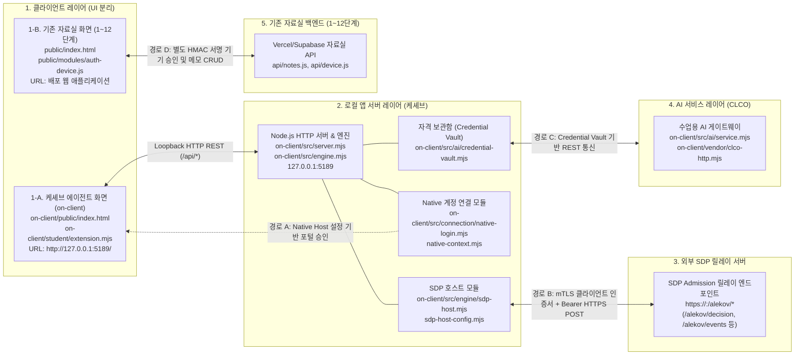

# 보안 Agent 「케셰브」 기술 명세서 및 실행 런북

로컬 보안 Agent 케셰브의 시스템 구성도, 데이터 흐름, 컴포넌트 경계, 실행 절차 및 장애 복구 규격을 정의합니다.

---

## 1. 시스템 개요

케셰브는 엔드포인트 보호 및 제로 트러스트(ZTNA) 접근 제어 상태를 시각화하는 로컬 보안 Agent입니다. 
사내 직원의 단말에서 신원과 기기 승인 상태를 검증합니다. 
업무 애플리케이션 접근 인가 결과와 보안 사건(XDR) 기록을 조회하여 표시합니다. 
소프트웨어 의존성 취약점(OSV) 점검 상태를 분류합니다. 
수업용 AI 게이트웨이(CLCO)와 연동하여 보안 사건 원인 설명과 권고 조치 상태를 렌더링합니다.

### 핵심 기능 목록 (학생 화면 구현 영역)
- **신원 및 기기 세션 표시**: 사용자 신원, 기기 상태, 활성 세션 정보 표시 (`renderIdentity`)
- **업무 앱 인가 결과 렌더링**: 앱별 인가 판정 결과(`allow`, `deny`, `challenge`) 및 사유 표시 (`renderDecision`)
- **보안 사건 모니터링**: XDR 보안 이벤트, 침해 시도 근거, 규칙 매칭 내역 렌더링 (`renderEvents`)
- **보호 현황 매트릭스**: 단말 상태, 세션 건수, 시스템 알림, 진단 지표 집약 표시 (`renderStatus`)
- **AI 게이트웨이 점검 상태 표시**: AI 인증 상태, 가용 모델 수, 점검 시각 렌더링 (`renderAiConnection`)
- **보안 사건 AI 설명 렌더링**: 이상 사건에 대한 AI 원인 분석 보고서 및 주의사항 표시 (`renderExplanation`)
- **보안 조치 상태 뷰**: 전달받은 조치 진행 상태(`prepared`, `pending`, `succeeded`, `denied` 등)와 영수증 정보 표시 (`renderAction`)
- **의존성 취약점 점검 표시**: 프로젝트 패키지 취약점 스캔 상태 및 결과 렌더링 (`renderVulnerabilities`)

---

## 2. 시스템 구성도 및 통신 경로

케셰브는 로컬 UI, 로컬 백엔드 서버, 외부 SDP 릴레이 서버, 수업용 AI 게이트웨이 및 기존 배포 자료실 API로 구성됩니다.
상호 독립적인 3대 통신 경로(Native 계정 연결, SDP mTLS HTTPS 릴레이, 기존 자료실 API)를 분리하여 운영합니다.
케셰브 화면과 기존 자료실 화면은 분리된 클라이언트로 동작하며 상호 직접 통신하지 않습니다.

### 2.1 아키텍처 다이어그램



### 2.2 독립 3대 통신 경로 및 데이터 흐름

1. **경로 A: Native 계정 연결 경로 (로컬 계정 승인)**
   - 모듈: `on-client/src/connection/native-login.mjs`, `native-context.mjs`
   - 방식: `-NativeHostConfig` 옵션으로 주입된 설정을 바탕으로 로컬 포털 승인 번호를 확인하고 계정 컨텍스트를 바인딩합니다.
   - 특징: SDP 릴레이와 독립된 로컬 사용자 인증 절차입니다.
2. **경로 B: 외부 SDP 릴레이 인증·인가 경로 (mTLS HTTPS 통신)**
   - 모듈: `on-client/src/engine/sdp-host.mjs`, `sdp-host-config.mjs`
   - 엔드포인트: 외부 SDP 서버의 `https://<host>:<port>/alekov/decision`, `/alekov/context`, `/alekov/events`, `/alekov/devices`, `/alekov/sessions`
   - 프로토콜: **mTLS(클라이언트 인증서 `certFile`, 개인키 `keyFile`, `caFile`) 및 Bearer 토큰(`tokenFile`) 기반의 HTTPS POST 릴레이 요청**
   - 역할: 인가 결정(`decideAccess`) 및 사건·기기·세션 관측 데이터를 외부 SDP 릴레이로부터 수신합니다. 케셰브 화면(`ClientAgent`)의 요청은 로컬 서버를 거쳐 이 릴레이 경로로 전달됩니다.
3. **경로 C: 기존 자료실 API 경로 (1~12단계 배포 서비스)**
   - 클라이언트 및 모듈: 기존 자료실 화면(`public/modules/auth-device.js`) 및 백엔드 `api/notes.js`, `api/device.js`
   - 방식: 기존 자료실 화면(`ClientVault`)이 Vercel/Supabase 상에 배포된 자료실 API와 직접 통신하여 HMAC-SHA256 기기 승인 및 메모 CRUD를 수행합니다.
   - 분리 원칙: 케셰브 대시보드(`on-client/public/app.js`)는 동일 출처 CSP 제한에 따라 로컬 서버(`127.0.0.1:5189`)와만 통신하며, 기존 자료실 API(`api/notes.js`, `api/device.js`)를 직접 호출하지 않습니다.

### 2.3 컴포넌트별 역할 정의

| 컴포넌트 | 위치 | 역할 정의 |
|---|---|---|
| **케셰브 에이전트 화면** | `on-client/public/`<br/>`on-client/student/extension.mjs` | 로컬 Agent UI를 렌더링합니다. 동일 출처 로컬 서버와만 통신하며, 자료실 API를 직접 호출하지 않습니다. |
| **기존 자료실 화면** | 루트 `public/`<br/>`public/modules/auth-device.js` | 1~12단계 배포 웹 UI입니다. 별도 자료실 API로 HMAC 기기 승인 및 메모 조회를 직접 요청합니다. |
| **로컬 앱 서버** | `on-client/src/server.mjs`<br/>`on-client/src/engine.mjs` | 루프백(127.0.0.1) REST API를 서빙합니다. Credential Vault를 격리 운영합니다. |
| **SDP 호스트 모듈** | `on-client/src/engine/sdp-host.mjs`<br/>`sdp-host-config.mjs` | 외부 SDP 릴레이 서버와 mTLS HTTPS 통신을 수행합니다. 인가 및 사건 데이터를 검증합니다. |
| **외부 SDP 릴레이 서버** | `https://<host>:<port>/alekov/*` | mTLS와 Bearer 토큰을 검증하고, ZTNA 접근 인가 판정 및 감사 이벤트를 회신합니다. |
| **AI 게이트웨이 (CLCO)** | `on-client/src/ai/`<br/>`on-client/vendor/clco-http.mjs` | 수업용 모델 목록을 공급합니다. 보안 사건 분석 질의를 중계합니다. |
| **기존 자료실 API** | 루트 `api/notes.js`, `api/device.js` | 1~12단계 배포 인프라입니다. 기존 자료실 화면(`public/`)의 HMAC 기기 승인 및 메모 요청을 독립 처리합니다. |

---

## 3. 지원 환경 및 스펙

| 구분 | 환경 기준 | 미지원 및 제한 사항 |
|---|---|---|
| **운영체제** | Windows 10 / 11 (PowerShell 5.1 / 7.x) | 비-Windows OS에서 `.ps1` 직접 실행 불가 (`npm start` 대체) |
| **Node.js** | **v24.19.0** (수업 및 자동 검사 표준) | Node.js 21 이하 버전 구동 차단 (실행 도구 검증 실패) |
| **npm** | **11.17.0** (실측 확인 완료) | - |
| **런타임 의존성** | `on-client`는 외부 npm 패키지 없음 | Node.js 순수 표준 라이브러리로만 구동 |
| **클라이언트** | 최신 Chromium 기반 브라우저 (Chrome, Edge) | 레거시 브라우저 미지원 |

---

## 4. 설치 및 실행 절차

### 4.1 작업 디렉토리 진입
```powershell
cd C:\Users\user\Desktop\task\choi-bujang-secret-vault\on-client
```

### 4.2 실행 명령어

- **표준 실행 (PowerShell 래퍼)**:
  ```powershell
  powershell -NoProfile -ExecutionPolicy Bypass -File .\tools\start-alekov.ps1
  ```
- **대체 실행 (npm 스크립트)**:
  ```powershell
  npm start
  ```
- **포트 충돌 해결 실행**:
  ```powershell
  powershell -NoProfile -ExecutionPolicy Bypass -File .\tools\start-alekov.ps1 -Port 5190
  ```
- **가상 데이터 확인 실행**:
  ```powershell
  npm run demo
  ```
- **확장 모듈 문법 검사**:
  ```powershell
  npm run check
  ```

### 4.3 접속 및 시작 확인
- **접속 URL**: [http://127.0.0.1:5189/](http://127.0.0.1:5189/)
- **정상 시작 콘솔 신호**:
  ```text
  케셰브가 켜졌습니다. 브라우저에서 http://127.0.0.1:5189/ 을 여세요.
  서버가 응답한 것만 확인했습니다. AI 연결 상태는 화면에서 따로 확인해 주세요.
  ```

### 4.4 종료 및 재실행
- **종료**: 실행 중인 PowerShell 창에서 `Ctrl + C`를 입력합니다.
- **재실행**: 종료 확인 후 4.2의 실행 명령어를 다시 입력합니다. 데이터와 기존 코드는 온전히 보존됩니다.

---

## 5. 컴포넌트 경계

`.on-starter-manifest.json` 무결성 검증을 기준으로 제공 코드와 학생 개발 영역을 엄격히 분리합니다.

### 5.1 제공 프레임워크 영역 (수정 금지)
- `on-client/src/server.mjs`: 로컬 HTTP 라우팅 및 정적 파일 서빙
- `on-client/src/engine/sdp-host.mjs`: 외부 SDP 릴레이 서버와의 mTLS HTTPS 통신 및 데이터 캡슐화
- `on-client/src/connection/`: Native 계정 연결 관리
- `on-client/src/ai/`: CLCO 게이트웨이 클라이언트 및 Credential Vault 관리
- `on-client/src/vulnerabilities/project-scan.mjs`: 로컬 락파일 파싱 및 패키지 쿼리 빌드
- `on-client/public/app.js`: 데이터 폴링 및 전역 이벤트 오케스트레이션
- `on-client/tools/start-alekov.ps1`: 실행 전 환경 검증 및 부팅 래퍼

### 5.2 학생 구현 영역 (`on-client/student/extension.mjs`)
학생은 `createStudentView` 내부의 8대 화면 표시(View) 함수를 구현하였습니다:
- `renderIdentity`: 사용자 신원, 기기 상태, 세션 정보 DOM 렌더링
- `renderDecision`: 인가 판정 배지 및 거절 사유 렌더링
- `renderEvents`: 보안 이벤트 목록, 증거, 룰 식별자 렌더링
- `renderStatus`: 기기, 세션, 알림 매트릭스 렌더링
- `renderAiConnection`: AI 인증 상태, 가용 모델 수, 점검 시각 렌더링 (모델명 목록이나 네트워크 지연시간은 표시하지 않음)
- `renderExplanation`: AI 사건 해석 리포트 및 주의사항 렌더링
- `renderAction`: 전달받은 조치 상태(`idle`, `prepared`, `pending`, `succeeded` 등) 및 영수증 렌더링 (실행기가 아닌 상태 뷰어)
- `renderVulnerabilities`: 패키지 취약점 스캔 결과 상태 렌더링

---

## 6. 장애 복구 가이드 (Troubleshooting)

### 6.1 실행 도구 콘솔 오류

| 출력 메시지 | 발생 원인 | 조치 절차 |
|---|---|---|
| `Node.js 가 없습니다` | 런타임 미설치 또는 환경변수 PATH 누락 | Node.js 24.19.0 설치 후 새 터미널에서 재실행 |
| `지금 Node.js 는 vXX 입니다` | 비호환 Node.js 버전 실행 | Node.js 24.19.0으로 전환 후 재실행 |
| `포트 5189 를 다른 프로그램이 쓰고 있습니다` | 포트 5189 점유 충돌 | `.\tools\start-alekov.ps1 -Port 5190` 명령으로 포트 변경 실행 |
| `앱 폴더가 아닙니다` | 잘못된 디렉토리에서 스크립트 실행 | `cd on-client` 이동 후 재실행 |
| `…초 안에 뜨지 않았습니다` | 프로세스 부팅 타임아웃 | 백그라운드 프로세스 정리 후 재실행 |

### 6.2 애플리케이션 상태 코드 및 화면 문구

| 화면 상태 문구 | 관련 상태 코드 | 원인 분석 | 복구 절차 |
|---|---|---|---|
| **연결 없음** | `disconnected`, `NOT_MOUNTED` | 호스트 설정 미주입 기본 실행 | 정상 상태. 별도 호스트 연동 시 `-SdpHostConfig` 지정 |
| **예제** | `demo` | 데모 모드 활성화 | `npm run demo` 실행 결과. 실제 검증 시 표준 명령으로 재구동 |
| **승인 대기** | `awaiting_approval` | AI 연결 승인 대기 중 | 화면의 6자리 승인 번호 확인 후 포털에서 승인 완료 |
| **권한 준비 중** | `ON_AI_PROVISIONING_PENDING` | AI 계정 권한 미발급 | 운영자 권한 반영 대기 |
| **확인 불가** | `UNVERIFIED`, `CONTRACT_MISMATCH` | 응답 계약 검증 실패 | 화면 새로고침 및 도움정보 점검 |
| **조회 실패** | `SERVER_UNAVAILABLE`, `TIMEOUT` | 네트워크 통신 장애 | 로컬 서버 구동 여부 확인 후 재시도 |
| **프로젝트 미설정** | `PROJECT_NOT_CONFIGURED` (`not_configured`) | 프로젝트 절대경로 설정 누락 | 담당자에게 프로젝트 경로를 확인한 뒤 설정을 주입하고 수동 재조회 |
| **승인된 패키지 없음** | `NO_APPROVED_PACKAGES` (`not_checked`) | 공개 조회 승인 목록에 일치하는 패키지 부재 | 정상 분기 (`packages: []`). 담당자에게 공개 조회 승인 목록을 확인한 뒤 수동 재조회 |
| **락파일 검증 불가** | `LOCKFILE_UNVERIFIABLE` (`unverifiable`) | lockfile 파일 변조 또는 무결성 검증 실패 | 락파일 무결성을 확인하고 수동 재조회 |

---

## 7. 지원 범위 및 미확인(UNV) 스펙

시스템의 실제 지원 범위는 **화면 구현**, **별도 설정이 필요한 제공 연결**, **기본 미지원 집행**의 3단계로 명확히 구분됩니다.

### 7.1 계층별 지원 범위
1. **학생 화면 구현 영역 (검증 완료)**:
   - 8대 UI 렌더러 함수의 DOM 생성(`createElement`), 텍스트 분기(`textContent`), 버튼 이벤트 바인딩 완료
   - `renderAiConnection`: AI 인증 상태, 모델 수(`modelCount`), 점검 시각(`checkedAt`) 렌더링 확인 (모델명 목록이나 네트워크 지연시간은 미표시)
   - `renderAction`: 전달받은 조치 상태(`idle`, `prepared`, `pending`, `succeeded`, `denied`, `unknown` 등) 표시 뷰어 동작 확인
2. **별도 설정이 필요한 제공 연결 영역 (설정 주입 시 동작)**:
   - `-NativeHostConfig`: Native 계정 연결 및 승인 컨텍스트 바인딩
   - `-SdpHostConfig`: 외부 SDP 릴레이 서버와의 mTLS 클라이언트 인증서 기반 HTTPS 인가·사건 조회
   - 기본 실행 시에는 해당 설정이 주입되지 않으므로 `연결 없음`(`NOT_MOUNTED`) 상태로 대기
3. **기본 미지원 집행 영역 (플랫폼 정책상 미지원)**:
   - `renderAction`은 조치 실행기가 아니며 상태 뷰어에 불과합니다.
   - 기본 조치 요청은 `ACTION_UNSUPPORTED`를 반환합니다.
   - 일반 SDP 기록의 `supportedActions`는 비어 있습니다 (`[]`). 실제 원격 조치 집행은 지원되지 않습니다.

### 7.2 미확인(기다림 - UNV) 항목
- `UNV-01` **운영 SDP 호스트 mTLS 실제 통신 확인**: 로컬 코드 규격은 갖추어져 있으나, 실제 운영 SDP 릴레이 서버와의 실시간 mTLS 핸드셰이크는 별도 설정 부재로 미확인 상태 유지
- `UNV-02` **운영 상용 AI 모델 유료 생성 호출**: CLCO 게이트웨이의 상용 LLM 유료 실시간 토큰 과금 호출은 미확인 상태 유지
- `UNV-03` **엔터프라이즈 계정 실시간 강제 회수 집행**: 원격 Active Directory/LDAP 연계 계정 정지 집행은 미지원 및 미확인 상태 유지
- `UNV-04` **글로벌 OSV 데이터베이스 라이브 온라인 전수 쿼리**: 수백 개 서드파티 의존성에 대한 실시간 글로벌 OSV 온라인 전수 질의는 허용 목록 부재로 미확인 상태 유지

---

## 8. 22단계 최종 커밋의 새 환경 재현 및 릴리스 기록

동일한 최종 커밋 소스코드를 기존 폴더와 격리된 새 빈 폴더에서 내려받아 런타임 검증, 설치, 기동, 브라우저 접속, 종료 및 재실행을 수행한 학생 직접 재현 기록입니다.

### 8.1 기준 형상 정보
- **저장소 URL**: `https://github.com/altdmfk/choi-bujang-secret-vault.git`
- **대상 브랜치**: `main`
- **기준 40자리 커밋 해시**: `cd31b199011e3dc2dcfb5497ab93a1c24cf40a94`
- **현재 버전 상태**: `v0.2.11` (검증 중인 버전, Release Candidate)
  > [!IMPORTANT]
  > 22단계 통과는 원문 검토 기준의 수료 판정이며, 실제 운영 인증이나 v1.0 자동 인증이 아닙니다. 19단계 실제 원격 조치 집행기 연동과 21·22단계 공식 접수 서명 연결이 완료되기 전까지는 정식 `v1.0`으로 표기하지 않고 검증 중인 버전으로 유지합니다.

### 8.2 새 환경 독립 재현 절차
1. **작업 폴더 격리 및 클론**:
   - 기존 작업 폴더(`choi-bujang-secret-vault`)와 설정 파일을 온전히 보존합니다.
   - 새 빈 디렉토리를 생성하고 동일 커밋을 클론합니다.
     ```powershell
     git clone https://github.com/altdmfk/choi-bujang-secret-vault.git choi-bujang-repro
     cd choi-bujang-repro
     git checkout cd31b199011e3dc2dcfb5497ab93a1c24cf40a94
     ```
2. **런타임 환경 검증**:
   - Node.js 및 npm 버전이 명세와 일치하는지 확인합니다.
     ```powershell
     node -v   # v24.19.0 확인
     npm -v    # 11.17.0 확인
     ```
3. **독립 설치 및 확장 모듈 문법 점검**:
   - 기존 폴더의 임의 인증 파일이나 환경변수 파일을 복사하지 않고 자체 의존성을 확인합니다.
     ```powershell
     npm --prefix on-client run check
     ```
4. **로컬 서버 기동 및 브라우저 확인**:
   - `on-client` 디렉토리로 이동하여 표준 기동을 수행합니다.
     ```powershell
     cd on-client
     powershell -NoProfile -ExecutionPolicy Bypass -File .\tools\start-alekov.ps1
     ```
   - 브라우저에서 `http://127.0.0.1:5189/`에 접속하여 케셰브 에이전트 대시보드 렌더링을 확인합니다.
5. **정상 종료 및 재실행 확인**:
   - 터미널에서 `Ctrl + C`를 입력하여 서버를 정상 종료합니다.
   - 다시 기동 명령을 실행하여 프로세스가 충돌 없이 바인딩되고 이전과 동일하게 브라우저 응답이 복원되는지 확인합니다.

### 8.3 누적 기능 재현 결과 표 (13~21단계)

결과 분류 기준:
- `재현됨`: 새 환경에서 직접 실행하여 정상 화면 렌더링 및 응답을 확인한 항목
- `연결 없음`: 기본 단독 기동 시 외부 호스트 설정 미주입으로 안전 대기 상태를 확인한 항목
- `확인 불가`: 계약 불일치 또는 데이터 무결성 오류로 렌더링이 중단된 항목
- `재현 안 됨`: 로직 오류나 런타임 결함으로 동작이 실패한 항목

| 단계 | 확인한 기능 | 결과 | 확인 시각 | 비고 (근거, 예제 구분, 미확인 원인) |
|---|---|---|---|---|
| **13단계** | 신원 및 기기 세션 표시 (`renderIdentity`) | `연결 없음` | 2026-10-23 13:44 | 기본 기동 시 Native 호스트 미주입 대기 확인 (`NOT_MOUNTED`). `npm run demo` 기동 시 `예제 자료` 배지 및 가상 세션 렌더링 확인됨 |
| **14단계** | 업무 앱 접근 인가 판정 (`renderDecision`) | `연결 없음` | 2026-10-23 13:44 | 기본 기동 시 SDP 릴레이 미연결 대기 확인. `npm run demo` 실행 시 `예제 자료` 배지 및 인가 배지(`allow`, `deny`, `challenge`) 렌더링 확인됨 |
| **15단계** | 보안 사건 모니터링 (`renderEvents`) | `연결 없음` | 2026-10-23 13:44 | 기본 기동 시 관측 이벤트 없음 대기 확인. `npm run demo` 기동 시 `예제 자료` 5건 사건 목록, 필터링, 탐지 규칙 배지 확인됨 |
| **16단계** | 보호 현황 매트릭스 (`renderStatus`) | `연결 없음` | 2026-10-23 13:44 | 기본 기동 시 단말 상태 및 0건 지표 확인. `npm run demo` 기동 시 `예제 자료` 기기 점검, 세션 수 집약 렌더링 확인됨 |
| **17단계** | AI 게이트웨이 점검 상태 (`renderAiConnection`) | `연결 없음` | 2026-10-23 13:44 | 기본 기동 시 `승인 대기` 또는 `권한 준비 중` 안전 분기 확인. 모델 수·시각 렌더링 확인. 상용 유료 AI 실호출은 미확인(`UNV-02`) |
| **18단계** | 보안 사건 AI 설명 렌더링 (`renderExplanation`) | `연결 없음` | 2026-10-23 13:44 | 기본 기동 시 사건 설명 대기. `npm run demo` 기동 시 `예제 자료` 기반 AI 이상 징후 분석 리포트 렌더링 확인됨 |
| **19단계** | 보안 조치 상태 뷰 (`renderAction`) | `연결 없음` | 2026-10-23 13:44 | 기본 기동 시 `idle` 상태 표시. 실제 원격 보안 조치 집행기는 플랫폼 미연결(`ACTION_UNSUPPORTED`) 상태 유지. 실행기가 아닌 상태 뷰어로 동작 확인됨 |
| **20단계** | 패키지 의존성 취약점 점검 (`renderVulnerabilities`) | `재현됨` | 2026-10-23 13:44 | 로컬 매니페스트 및 lockfile 무결성 파싱 동작. 공개 조회 승인 목록에 일치 패키지 없어 `승인된 패키지 없음`(`packages: []`) 정상 상태 렌더링 확인 |
| **21단계** | 런북 규격 실행 및 재실행 | `재현됨` | 2026-10-23 13:44 | `npm run check` 통과. 표준 기동 스크립트 실행 후 `http://127.0.0.1:5189/` 정상 응답, `Ctrl + C` 종료 후 재기동 성공 확인 |

### 8.4 데이터 보존 및 백업·복원 계획
1. **학생 데이터 보존 원칙**:
   - 로컬 브라우저 영구 저장소(`localStorage`/`sessionStorage`)에 세션 및 토큰을 영구 보존하지 않고 인메모리 객체로 관리합니다.
   - 기존 1~12단계 자료실 데이터는 Supabase 원격 DB 사본(`notes_backup`)을 통해 보존됩니다.
2. **백업 절차**:
   - 자료실 메모 복원을 위한 비공개 사본 해시 체계(`notes_backup`)를 유지합니다.
   - 설정 복원을 위한 Git 커밋 태그 및 SHA 히스토리를 보존합니다.
3. **복원 절차 및 제한**:
   - **메모 단건 복원**: `POST /api/restore`를 통해 사본 해시와 소유자가 일치하는 경우에만 단건 복원을 허용하며, `dryRun: true`를 통한 사전 검증 및 불일치 시 직전 상태 자동 롤백(`HTTP 409`)을 보장합니다.
   - **정책 복원**: `npm run policy:restore -- <커밋 SHA>` 도구를 통해 안전 커밋의 시험 정책(`aleph.config.json`)을 안전하게 복구합니다.
   - **복원 제한**: 변조된 사본 주입, 타인 소유 자원 복원 요청은 차단되며, 실시간 상용 데이터베이스 롤백은 지원 범위에 포함되지 않습니다.

### 8.5 이동 가능한 환경 구성 규격 (Portability)
1. **절대경로 의존성 배제**:
   - 소스코드 및 설정 파일 내에 특정 개발자 PC의 로컬 절대경로(예: `C:\Users\...`) 하드코딩을 일체 배제합니다.
   - 모든 상대 경로는 프로젝트 루트 및 실행 진입점 디렉토리를 기준으로 해석합니다.
2. **비밀값 분리 및 설정 예시 제공**:
   - API 키, 서비스 토큰, 인증서 개인키는 소스코드에 포함하지 않으며 환경변수(`.env.local`) 또는 실행 인자로 주입합니다.
   - 환경변수 템플릿(`.env.example`)을 제공하여 새 환경에서 필요한 키 목록을 즉시 파악할 수 있도록 지원합니다.
3. **순수 표준 라이브러리 기반 구동**:
   - `on-client`는 외부 npm 모듈 설치 없이 Node.js 순수 표준 라이브러리(HTTP, Crypto, FS 등)만으로 즉시 구동됩니다.

### 8.6 버전 표기 및 최종 지원 범위
- **현재 표기 버전**: `v0.2.11` (검증 중인 버전)
- **정식 v1.0 미발행 사유**:
  - 19단계 실제 원격 조치 집행기 연결 부재 (`ACTION_UNSUPPORTED`, `supportedActions: []` 상태 유지)
  - 21·22단계 공식 접수 및 서명 자동 검증기 미연결
  - 운영 SDP 릴레이 서버와의 실제 mTLS 연동(`UNV-01`) 및 상용 AI LLM 호출(`UNV-02`) 미확인 상태 유지
- **최종 검증 결론**:
  - 동일한 최종 커밋(`cd31b199011e3dc2dcfb5497ab93a1c24cf40a94`)을 기준으로 소스코드, 런북, 구성도, 재현 기록이 완전한 일관성을 충족함을 확인하였습니다.
