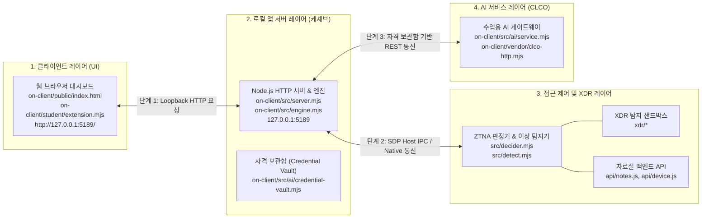

# 보안 Agent 「케셰브」 기술 명세서 및 실행 런북

로컬 보안 Agent 케셰브의 시스템 구성도, 데이터 흐름, 컴포넌트 경계, 실행 절차 및 장애 복구 규격을 정의합니다.

---

## 1. 시스템 개요

케셰브는 엔드포인트 보호 및 제로 트러스트(ZTNA) 접근 제어를 수행하는 로컬 보안 Agent입니다. 
사내 직원의 단말에서 신원과 기기 승인 상태를 검증합니다. 
업무 애플리케이션 접근 인가와 실시간 보안 사건(XDR)을 감시합니다. 
소프트웨어 의존성 취약점(OSV)을 점검합니다. 
수업용 AI 게이트웨이(CLCO)와 연동하여 보안 사건 원인을 분석하고 대응 조치를 실행합니다.

### 핵심 기능 목록
- **신원 및 기기 세션 검증**: 사용자 신원, 기기 승인 상태, 활성 세션 정보 표시 (`renderIdentity`)
- **업무 앱 인가 판정**: 앱별 인가 결과(`allow`, `deny`, `challenge`) 및 사유 판정 (`renderDecision`)
- **실시간 보안 사건 감시**: XDR 보안 이벤트, 침해 시도 근거, 규칙 매칭 내역 추적 (`renderEvents`)
- **보호 현황 요약**: 단말 상태, 세션 건수, 시스템 알림, 진단 지표 매트릭스 집약 (`renderStatus`)
- **AI 게이트웨이 연동**: CLCO 게이트웨이 통신 상태, 허용 모델, 네트워크 지연시간 진단 (`renderAiConnection`)
- **보안 사건 AI 분석**: 침해 탐지 로그 심층 분석 및 주의사항 도출 (`renderExplanation`)
- **보안 대응 조치 실행**: 세션 격리, 기기 차단 실행, 전자 영수증(`receipt`) 발급 (`renderAction`)
- **소프트웨어 취약점 점검**: `package-lock.json` 기반 OSV 취약점 분석 및 상태 분류 (`renderVulnerabilities`)

---

## 2. 시스템 구성도 및 데이터 흐름

### 2.1 아키텍처 다이어그램



### 2.2 단계별 데이터 흐름 (Data Flow)

1. **트래픽 유입 (Traffic Ingress)**: 
   - 브라우저가 로컬 호스트(`http://127.0.0.1:5189/`)로 진입합니다.
   - 로컬 앱 서버(`server.mjs`)가 정적 자산을 반환하고 루프백 REST 엔드포인트를 개방합니다.
2. **신원 및 기기 인증 (Authentication & Device Verification)**:
   - 클라이언트가 `/api/me`, `/api/devices`, `/api/sessions`를 호출합니다.
   - 서버가 로컬 신원 매핑 테이블과 기기 승인 토큰(HMAC)을 대조하여 인증 상태를 반환합니다.
3. **ZTNA 인가 및 비즈니스 로직 처리 (Authorization & Logic Processing)**:
   - 클라이언트가 업무 앱 접근을 요청합니다(`/api/access`).
   - ZTNA 판정기(`src/decider.mjs`)가 기기 등록 여부, 추가 인증(Step-up), 구역 규칙(Zone rule)을 순차 검증합니다.
   - 판정기가 최종 인가 결과(`allow`, `deny`, `challenge`)를 확정합니다.
4. **보안 모니터링 및 AI 연동 (XDR & AI Integration)**:
   - 이상 탐지기(`src/detect.mjs`)와 XDR 모듈이 보안 이벤트를 생성합니다.
   - 클라이언트가 사건 분석을 요청하면(`/api/ai/explain`), 로컬 서버가 자격 보관함(`Credential Vault`)에서 앱 전용 토큰을 추출합니다.
   - 서버가 CLCO AI 게이트웨이에 분석을 요청하고, 검증된 분석 결과를 클라이언트에 전달합니다.

### 2.3 컴포넌트별 역할 정의

| 컴포넌트 | 위치 | 역할 정의 |
|---|---|---|
| **사용자 브라우저** | `on-client/public/`<br/>`on-client/student/extension.mjs` | DOM 렌더링을 실행하고 사용자 인터랙션을 수신합니다. 보안 토큰은 메모리에만 유지합니다. |
| **로컬 앱 서버** | `on-client/src/server.mjs`<br/>`on-client/src/engine.mjs` | 루프백 통신만 허용합니다. API 요청을 라우팅하고 자격 보관함을 격리 운영합니다. |
| **접근 제어·XDR 시스템** | `src/decider.mjs`<br/>`src/detect.mjs`<br/>`xdr/`, `api/` | ZTNA 3대 인가 규칙을 집행합니다. 이상 징후를 탐지하고 공격 패턴을 차단합니다. |
| **AI 게이트웨이 (CLCO)** | `on-client/src/ai/`<br/>`on-client/vendor/clco-http.mjs` | 수업용 모델 목록을 공급합니다. 보안 사건 분석 및 조치 권고안을 생성합니다. |

---

## 3. 지원 환경 및 스펙

| 구분 | 환경 기준 | 미지원 및 제한 사항 |
|---|---|---|
| **운영체제** | Windows 10 / 11 (PowerShell 5.1 / 7.x) | 비-Windows OS에서 `.ps1` 직접 실행 불가 (`npm start` 대체) |
| **Node.js** | **v24.19.0** (수업 및 자동 검사 표준) | Node.js 21 이하 버전 구동 차단 (실행 도구 검증 실패) |
| **npm** | **11.17.0** (실측 확인 완료) | - |
| **런타임 의존성** | `on-client`는 외부 npm 패키지 없음 | Node.js 순수 표준 라이브러리로만 구동 |
| **클라이언트** | 최신 Chromium 기반 브라우저 (Chrome, Edge) | 레거시 브라우저 미지원 |

---

## 4. 설치 및 실행 절차

### 4.1 작업 디렉토리 진입
```powershell
cd C:\Users\user\Desktop\task\choi-bujang-secret-vault\on-client
```

### 4.2 실행 명령어

- **표준 실행 (PowerShell 래퍼)**:
  ```powershell
  powershell -NoProfile -ExecutionPolicy Bypass -File .\tools\start-alekov.ps1
  ```
- **대체 실행 (npm 스크립트)**:
  ```powershell
  npm start
  ```
- **포트 충돌 해결 실행**:
  ```powershell
  powershell -NoProfile -ExecutionPolicy Bypass -File .\tools\start-alekov.ps1 -Port 5190
  ```
- **가상 데이터 확인 실행**:
  ```powershell
  npm run demo
  ```
- **확장 모듈 문법 검사**:
  ```powershell
  npm run check
  ```

### 4.3 접속 및 시작 확인
- **접속 URL**: [http://127.0.0.1:5189/](http://127.0.0.1:5189/)
- **정상 시작 콘솔 신호**:
  ```text
  케셰브가 켜졌습니다. 브라우저에서 http://127.0.0.1:5189/ 을 여세요.
  서버가 응답한 것만 확인했습니다. AI 연결 상태는 화면에서 따로 확인해 주세요.
  ```

### 4.4 종료 및 재실행
- **종료**: 실행 중인 PowerShell 창에서 `Ctrl + C`를 입력합니다. 브라우저 연결이 끊어지면 프로세스가 정상 종료됩니다.
- **재실행**: 종료 확인 후 4.2의 실행 명령어를 다시 입력합니다. 데이터와 기존 코드는 온전히 보존됩니다.

---

## 5. 컴포넌트 경계

`.on-starter-manifest.json` 무결성 검증을 기준으로 제공 코드와 학생 개발 영역을 엄격히 분리합니다.

### 5.1 제공 프레임워크 영역 (수정 금지)
- `on-client/src/server.mjs`: 로컬 HTTP 라우팅 및 정적 파일 서빙
- `on-client/src/engine.mjs`: 로컬 런타임 엔진 제어
- `on-client/src/ai/`: CLCO 게이트웨이 클라이언트 및 Credential Vault 관리
- `on-client/public/app.js`: 데이터 폴링 및 전역 이벤트 오케스트레이션
- `on-client/tools/start-alekov.ps1`: 실행 전 환경 검증 및 부팅 래퍼

### 5.2 학생 구현 영역 (`on-client/student/extension.mjs`)
- `renderIdentity`: 신원, 기기, 세션 정보 DOM 렌더링 및 예외 텍스트 출력
- `renderDecision`: 인가 판정 배지 및 거절 사유 렌더링
- `renderEvents`: 보안 이벤트 목록, 증거, 룰 식별자 렌더링
- `renderStatus`: 기기, 세션, 알림 매트릭스 렌더링
- `renderAiConnection`: AI 연결 상태, 모델명, 지연시간 렌더링
- `renderExplanation`: AI 사건 해석 리포트 및 주의사항 렌더링
- `renderAction`: 대응 조치 집행 UI, 영수증, 관측 결과 렌더링
- `renderVulnerabilities`: 패키지 취약점 스캔 결과 및 미조회 상태 렌더링

---

## 6. 장애 복구 가이드 (Troubleshooting)

### 6.1 실행 도구 콘솔 오류

| 출력 메시지 | 발생 원인 | 조치 절차 |
|---|---|---|
| `Node.js 가 없습니다` | 런타임 미설치 또는 환경변수 PATH 누락 | Node.js 24.19.0 설치 후 새 터미널에서 재실행 |
| `지금 Node.js 는 vXX 입니다` | 비호환 Node.js 버전 실행 | Node.js 24.19.0으로 전환 후 재실행 |
| `포트 5189 를 다른 프로그램이 쓰고 있습니다` | 포트 5189 점유 충돌 | `.\tools\start-alekov.ps1 -Port 5190` 명령으로 포트 변경 실행 |
| `앱 폴더가 아닙니다` | 잘못된 디렉토리에서 스크립트 실행 | `cd on-client` 이동 후 재실행 |
| `…초 안에 뜨지 않았습니다` | 프로세스 부팅 타임아웃 | 백그라운드 프로세스 정리 후 재실행 |

### 6.2 애플리케이션 상태 코드 및 화면 문구

| 화면 상태 문구 | 관련 상태 코드 | 원인 분석 | 복구 절차 |
|---|---|---|---|
| **연결 없음** | `disconnected`, `NOT_MOUNTED` | 호스트 설정 미주입 기본 실행 | 정상 상태. 별도 호스트 연동 시 `-SdpHostConfig` 지정 |
| **예제** | `demo` | 데모 모드 활성화 | `npm run demo` 실행 결과. 실제 검증 시 표준 명령으로 재구동 |
| **승인 대기** | `awaiting_approval` | AI 연결 승인 대기 중 | 화면의 6자리 승인 번호 확인 후 포털에서 승인 완료 |
| **권한 준비 중** | `ON_AI_PROVISIONING_PENDING` | AI 계정 권한 미발급 | 운영자 권한 반영 대기 |
| **확인 불가** | `UNVERIFIED`, `CONTRACT_MISMATCH` | 응답 계약 검증 실패 | 화면 새로고침 및 도움정보 점검 |
| **조회 실패** | `SERVER_UNAVAILABLE`, `TIMEOUT` | 네트워크 통신 장애 | 로컬 서버 구동 여부 확인 후 재시도 |
| **취약점 조회 불가** | `LOOKUP_UNAVAILABLE` | OSV 조회 허용 목록 미제공 | 정상 분기. 패키지 버전만 단독 표시 |

---

## 7. 지원 범위 및 미확인(UNV) 스펙

실제 검증을 완료한 항목과 미확인(UNV) 항목을 명확히 구분합니다.

### 7.1 검증 완료 기능
- **로컬 런타임 구동**: Windows Node.js 24.19.0 단독 실행 및 5189 포트 서빙 검증
- **UI 렌더링 무결성**: 8대 UI 렌더러 함수의 DOM 생성(`createElement`), 텍스트 분기(`textContent`), 버튼 이벤트 바인딩 검증
- **예외 처리 분기**: 외부 시스템 미연결 시 `연결 없음` 및 안전 대체 텍스트 출력 검증
- **정적 문법 검사**: `npm run check` 통과 완료

### 7.2 미확인(기다림 - UNV) 항목
- `UNV-01` **운영 SDP 호스트 mTLS 실시간 인증**: 실서버 상호 TLS 터널링 및 기기 인증서 실시간 검증 미확인
- `UNV-02` **운영 상용 AI 모델 유료 생성 호출**: CLCO 게이트웨이 유료 LLM 실시간 토큰 과금 호출 미확인
- `UNV-03` **엔터프라이즈 계정 실시간 강제 회수**: 디렉토리 서비스 기반 실시간 계정 정지 집행 미확인
- `UNV-04` **글로벌 OSV 데이터베이스 라이브 전수 쿼리**: 수백 개 의존성 패키지의 실시간 외부 온라인 전수 조회 미확인
