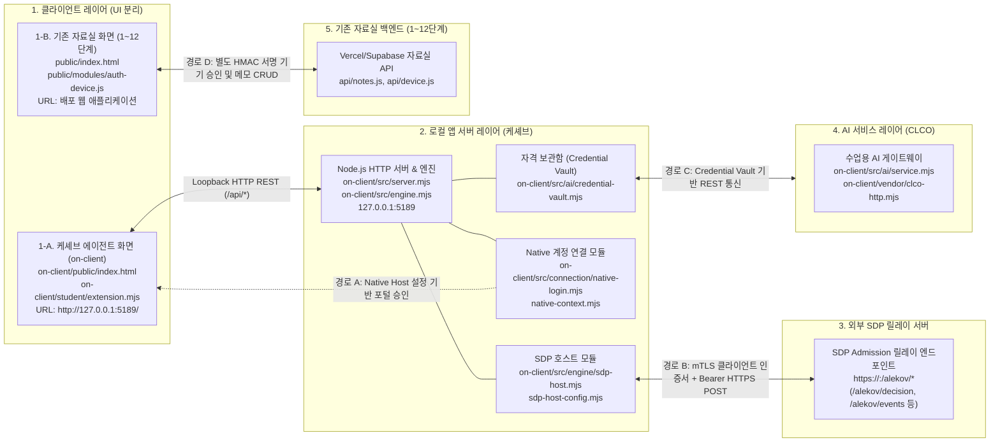

# 보안 Agent 「케셰브」 기술 명세서 및 실행 런북

로컬 보안 Agent 케셰브의 시스템 구성도, 데이터 흐름, 컴포넌트 경계, 실행 절차 및 장애 복구 규격을 정의합니다.

---

## 1. 시스템 개요

케셰브는 엔드포인트 보호 및 제로 트러스트(ZTNA) 접근 제어 상태를 시각화하는 로컬 보안 Agent입니다. 
사내 직원의 단말에서 신원과 기기 승인 상태를 검증합니다. 
업무 애플리케이션 접근 인가 결과와 보안 사건(XDR) 기록을 조회하여 표시합니다. 
소프트웨어 의존성 취약점(OSV) 점검 상태를 분류합니다. 
수업용 AI 게이트웨이(CLCO)와 연동하여 보안 사건 원인 설명과 권고 조치 상태를 렌더링합니다.

### 핵심 기능 목록 (학생 화면 구현 영역)
- **신원 및 기기 세션 표시**: 사용자 신원, 기기 상태, 활성 세션 정보 표시 (`renderIdentity`)
- **업무 앱 인가 결과 렌더링**: 앱별 인가 판정 결과(`allow`, `deny`, `challenge`) 및 사유 표시 (`renderDecision`)
- **보안 사건 모니터링**: XDR 보안 이벤트, 침해 시도 근거, 규칙 매칭 내역 렌더링 (`renderEvents`)
- **보호 현황 매트릭스**: 단말 상태, 세션 건수, 시스템 알림, 진단 지표 집약 표시 (`renderStatus`)
- **AI 게이트웨이 점검 상태 표시**: AI 인증 상태, 가용 모델 수, 점검 시각 렌더링 (`renderAiConnection`)
- **보안 사건 AI 설명 렌더링**: 이상 사건에 대한 AI 원인 분석 보고서 및 주의사항 표시 (`renderExplanation`)
- **보안 조치 상태 뷰**: 전달받은 조치 진행 상태(`prepared`, `pending`, `succeeded`, `denied` 등)와 영수증 정보 표시 (`renderAction`)
- **의존성 취약점 점검 표시**: 프로젝트 패키지 취약점 스캔 상태 및 결과 렌더링 (`renderVulnerabilities`)

---

## 2. 시스템 구성도 및 통신 경로

케셰브는 로컬 UI, 로컬 백엔드 서버, 외부 SDP 릴레이 서버, 수업용 AI 게이트웨이 및 기존 배포 자료실 API로 구성됩니다.
상호 독립적인 3대 통신 경로(Native 계정 연결, SDP mTLS HTTPS 릴레이, 기존 자료실 API)를 분리하여 운영합니다.
케셰브 화면과 기존 자료실 화면은 분리된 클라이언트로 동작하며 상호 직접 통신하지 않습니다.

### 2.1 아키텍처 다이어그램



### 2.2 독립 3대 통신 경로 및 데이터 흐름

1. **경로 A: Native 계정 연결 경로 (로컬 계정 승인)**
   - 모듈: `on-client/src/connection/native-login.mjs`, `native-context.mjs`
   - 방식: `-NativeHostConfig` 옵션으로 주입된 설정을 바탕으로 로컬 포털 승인 번호를 확인하고 계정 컨텍스트를 바인딩합니다.
   - 특징: SDP 릴레이와 독립된 로컬 사용자 인증 절차입니다.
2. **경로 B: 외부 SDP 릴레이 인증·인가 경로 (mTLS HTTPS 통신)**
   - 모듈: `on-client/src/engine/sdp-host.mjs`, `sdp-host-config.mjs`
   - 엔드포인트: 외부 SDP 서버의 `https://<host>:<port>/alekov/decision`, `/alekov/context`, `/alekov/events`, `/alekov/devices`, `/alekov/sessions`
   - 프로토콜: **mTLS(클라이언트 인증서 `certFile`, 개인키 `keyFile`, `caFile`) 및 Bearer 토큰(`tokenFile`) 기반의 HTTPS POST 릴레이 요청**
   - 역할: 인가 결정(`decideAccess`) 및 사건·기기·세션 관측 데이터를 외부 SDP 릴레이로부터 수신합니다. 케셰브 화면(`ClientAgent`)의 요청은 로컬 서버를 거쳐 이 릴레이 경로로 전달됩니다.
3. **경로 C: 기존 자료실 API 경로 (1~12단계 배포 서비스)**
   - 클라이언트 및 모듈: 기존 자료실 화면(`public/modules/auth-device.js`) 및 백엔드 `api/notes.js`, `api/device.js`
   - 방식: 기존 자료실 화면(`ClientVault`)이 Vercel/Supabase 상에 배포된 자료실 API와 직접 통신하여 HMAC-SHA256 기기 승인 및 메모 CRUD를 수행합니다.
   - 분리 원칙: 케셰브 대시보드(`on-client/public/app.js`)는 동일 출처 CSP 제한에 따라 로컬 서버(`127.0.0.1:5189`)와만 통신하며, 기존 자료실 API(`api/notes.js`, `api/device.js`)를 직접 호출하지 않습니다.

### 2.3 컴포넌트별 역할 정의

| 컴포넌트 | 위치 | 역할 정의 |
|---|---|---|
| **케셰브 에이전트 화면** | `on-client/public/`<br/>`on-client/student/extension.mjs` | 로컬 Agent UI를 렌더링합니다. 동일 출처 로컬 서버와만 통신하며, 자료실 API를 직접 호출하지 않습니다. |
| **기존 자료실 화면** | 루트 `public/`<br/>`public/modules/auth-device.js` | 1~12단계 배포 웹 UI입니다. 별도 자료실 API로 HMAC 기기 승인 및 메모 조회를 직접 요청합니다. |
| **로컬 앱 서버** | `on-client/src/server.mjs`<br/>`on-client/src/engine.mjs` | 루프백(127.0.0.1) REST API를 서빙합니다. Credential Vault를 격리 운영합니다. |
| **SDP 호스트 모듈** | `on-client/src/engine/sdp-host.mjs`<br/>`sdp-host-config.mjs` | 외부 SDP 릴레이 서버와 mTLS HTTPS 통신을 수행합니다. 인가 및 사건 데이터를 검증합니다. |
| **외부 SDP 릴레이 서버** | `https://<host>:<port>/alekov/*` | mTLS와 Bearer 토큰을 검증하고, ZTNA 접근 인가 판정 및 감사 이벤트를 회신합니다. |
| **AI 게이트웨이 (CLCO)** | `on-client/src/ai/`<br/>`on-client/vendor/clco-http.mjs` | 수업용 모델 목록을 공급합니다. 보안 사건 분석 질의를 중계합니다. |
| **기존 자료실 API** | 루트 `api/notes.js`, `api/device.js` | 1~12단계 배포 인프라입니다. 기존 자료실 화면(`public/`)의 HMAC 기기 승인 및 메모 요청을 독립 처리합니다. |

---

## 3. 지원 환경 및 스펙

| 구분 | 환경 기준 | 미지원 및 제한 사항 |
|---|---|---|
| **운영체제** | Windows 10 / 11 (PowerShell 5.1 / 7.x) | 비-Windows OS에서 `.ps1` 직접 실행 불가 (`npm start` 대체) |
| **Node.js** | **v24.19.0** (수업 및 자동 검사 표준) | Node.js 21 이하 버전 구동 차단 (실행 도구 검증 실패) |
| **npm** | **11.17.0** (실측 확인 완료) | - |
| **런타임 의존성** | `on-client`는 외부 npm 패키지 없음 | Node.js 순수 표준 라이브러리로만 구동 |
| **클라이언트** | 최신 Chromium 기반 브라우저 (Chrome, Edge) | 레거시 브라우저 미지원 |

---

## 4. 설치 및 실행 절차

### 4.1 작업 디렉토리 진입
```powershell
cd C:\Users\user\Desktop\task\choi-bujang-secret-vault\on-client
```

### 4.2 실행 명령어

- **표준 실행 (PowerShell 래퍼)**:
  ```powershell
  powershell -NoProfile -ExecutionPolicy Bypass -File .\tools\start-alekov.ps1
  ```
- **대체 실행 (npm 스크립트)**:
  ```powershell
  npm start
  ```
- **포트 충돌 해결 실행**:
  ```powershell
  powershell -NoProfile -ExecutionPolicy Bypass -File .\tools\start-alekov.ps1 -Port 5190
  ```
- **가상 데이터 확인 실행**:
  ```powershell
  npm run demo
  ```
- **확장 모듈 문법 검사**:
  ```powershell
  npm run check
  ```

### 4.3 접속 및 시작 확인
- **접속 URL**: [http://127.0.0.1:5189/](http://127.0.0.1:5189/)
- **정상 시작 콘솔 신호**:
  ```text
  케셰브가 켜졌습니다. 브라우저에서 http://127.0.0.1:5189/ 을 여세요.
  서버가 응답한 것만 확인했습니다. AI 연결 상태는 화면에서 따로 확인해 주세요.
  ```

### 4.4 종료 및 재실행
- **종료**: 실행 중인 PowerShell 창에서 `Ctrl + C`를 입력합니다.
- **재실행**: 종료 확인 후 4.2의 실행 명령어를 다시 입력합니다. 데이터와 기존 코드는 온전히 보존됩니다.

---

## 5. 컴포넌트 경계

`.on-starter-manifest.json` 무결성 검증을 기준으로 제공 코드와 학생 개발 영역을 엄격히 분리합니다.

### 5.1 제공 프레임워크 영역 (수정 금지)
- `on-client/src/server.mjs`: 로컬 HTTP 라우팅 및 정적 파일 서빙
- `on-client/src/engine/sdp-host.mjs`: 외부 SDP 릴레이 서버와의 mTLS HTTPS 통신 및 데이터 캡슐화
- `on-client/src/connection/`: Native 계정 연결 관리
- `on-client/src/ai/`: CLCO 게이트웨이 클라이언트 및 Credential Vault 관리
- `on-client/src/vulnerabilities/project-scan.mjs`: 로컬 락파일 파싱 및 패키지 쿼리 빌드
- `on-client/public/app.js`: 데이터 폴링 및 전역 이벤트 오케스트레이션
- `on-client/tools/start-alekov.ps1`: 실행 전 환경 검증 및 부팅 래퍼

### 5.2 학생 구현 영역 (`on-client/student/extension.mjs`)
학생은 `createStudentView` 내부의 8대 화면 표시(View) 함수를 구현하였습니다:
- `renderIdentity`: 사용자 신원, 기기 상태, 세션 정보 DOM 렌더링
- `renderDecision`: 인가 판정 배지 및 거절 사유 렌더링
- `renderEvents`: 보안 이벤트 목록, 증거, 룰 식별자 렌더링
- `renderStatus`: 기기, 세션, 알림 매트릭스 렌더링
- `renderAiConnection`: AI 인증 상태, 가용 모델 수, 점검 시각 렌더링 (모델명 목록이나 네트워크 지연시간은 표시하지 않음)
- `renderExplanation`: AI 사건 해석 리포트 및 주의사항 렌더링
- `renderAction`: 전달받은 조치 상태(`idle`, `prepared`, `pending`, `succeeded` 등) 및 영수증 렌더링 (실행기가 아닌 상태 뷰어)
- `renderVulnerabilities`: 패키지 취약점 스캔 결과 상태 렌더링

---

## 6. 장애 복구 가이드 (Troubleshooting)

### 6.1 실행 도구 콘솔 오류

| 출력 메시지 | 발생 원인 | 조치 절차 |
|---|---|---|
| `Node.js 가 없습니다` | 런타임 미설치 또는 환경변수 PATH 누락 | Node.js 24.19.0 설치 후 새 터미널에서 재실행 |
| `지금 Node.js 는 vXX 입니다` | 비호환 Node.js 버전 실행 | Node.js 24.19.0으로 전환 후 재실행 |
| `포트 5189 를 다른 프로그램이 쓰고 있습니다` | 포트 5189 점유 충돌 | `.\tools\start-alekov.ps1 -Port 5190` 명령으로 포트 변경 실행 |
| `앱 폴더가 아닙니다` | 잘못된 디렉토리에서 스크립트 실행 | `cd on-client` 이동 후 재실행 |
| `…초 안에 뜨지 않았습니다` | 프로세스 부팅 타임아웃 | 백그라운드 프로세스 정리 후 재실행 |

### 6.2 애플리케이션 상태 코드 및 화면 문구

| 화면 상태 문구 | 관련 상태 코드 | 원인 분석 | 복구 절차 |
|---|---|---|---|
| **연결 없음** | `disconnected`, `NOT_MOUNTED` | 호스트 설정 미주입 기본 실행 | 정상 상태. 별도 호스트 연동 시 `-SdpHostConfig` 지정 |
| **예제** | `demo` | 데모 모드 활성화 | `npm run demo` 실행 결과. 실제 검증 시 표준 명령으로 재구동 |
| **AI 앱 승인 대기** | `awaiting_approval` (`/api/ai/connect/*`) | AI 연결 승인 대기 중 | 화면에 표시된 **UUID 앞뒤 4글자 하이픈 연결 확인 번호(`xxxx-xxxx`, 9글자)** 확인 후 포털에서 승인 완료하고, 화면의 **`[승인했으며 연결 확인]`** (`ai-connect-finish`) 버튼을 클릭하여 완료 |
| **계정 연결 승인 대기** | `awaiting_approval` (`/api/native-login/*`) | Native 로컬 계정 연결 승인 대기 중 | 화면에 표시된 **6자리 숫자 승인 번호(`123456`)** 확인 후 포털에서 승인 완료하고, 화면의 **`[승인 번호로 로그인 완료]`** (또는 redeem) 버튼을 클릭하여 완료 |
| **권한 준비 중** | `ON_AI_PROVISIONING_PENDING` | AI 계정 권한 미발급 | 운영자 권한 반영 대기 |
| **확인 불가** | `UNVERIFIED`, `CONTRACT_MISMATCH` | 응답 계약 검증 실패 | 화면 새로고침 및 도움정보 점검 |
| **조회 실패** | `SERVER_UNAVAILABLE`, `TIMEOUT` | 네트워크 통신 장애 | 로컬 서버 구동 여부 확인 후 재시도 |
| **프로젝트 미설정** | `PROJECT_NOT_CONFIGURED` (`not_configured`) | 프로젝트 절대경로 설정 누락 | 담당자에게 프로젝트 경로를 확인한 뒤 설정을 주입하고 수동 재조회 |
| **승인된 패키지 없음** | `NO_APPROVED_PACKAGES` (`not_checked`) | 공개 조회 승인 목록에 일치하는 패키지 부재 | 정상 분기 (`packages: []`). 담당자에게 공개 조회 승인 목록을 확인한 뒤 수동 재조회 |
| **락파일 검증 불가** | `LOCKFILE_UNVERIFIABLE` (`unverifiable`) | lockfile 파일 변조 또는 무결성 검증 실패 | 락파일 무결성을 확인하고 수동 재조회 |

---

## 7. 지원 범위 및 미확인(UNV) 스펙

시스템의 실제 지원 범위는 **화면 구현**, **별도 설정이 필요한 제공 연결**, **기본 미지원 집행**의 3단계로 명확히 구분됩니다.

### 7.1 계층별 지원 범위
1. **학생 화면 구현 영역 (검증 완료)**:
   - 8대 UI 렌더러 함수의 DOM 생성(`createElement`), 텍스트 분기(`textContent`), 버튼 이벤트 바인딩 완료
   - `renderAiConnection`: AI 인증 상태, 모델 수(`modelCount`), 점검 시각(`checkedAt`) 렌더링 확인 (모델명 목록이나 네트워크 지연시간은 미표시)
   - `renderAction`: 전달받은 조치 상태(`idle`, `prepared`, `pending`, `succeeded`, `denied`, `unknown` 등) 표시 뷰어 동작 확인
2. **별도 설정이 필요한 제공 연결 영역 (설정 주입 시 동작)**:
   - `-NativeHostConfig`: Native 계정 연결 및 승인 컨텍스트 바인딩
   - `-SdpHostConfig`: 외부 SDP 릴레이 서버와의 mTLS 클라이언트 인증서 기반 HTTPS 인가·사건 조회
   - 기본 실행 시에는 해당 설정이 주입되지 않으므로 `연결 없음`(`NOT_MOUNTED`) 상태로 대기
3. **기본 미지원 집행 영역 (플랫폼 정책상 미지원)**:
   - `renderAction`은 조치 실행기가 아니며 상태 뷰어에 불과합니다.
   - 기본 조치 요청은 `ACTION_UNSUPPORTED`를 반환합니다.
   - 일반 SDP 기록의 `supportedActions`는 비어 있습니다 (`[]`). 실제 원격 조치 집행은 지원되지 않습니다.

### 7.2 미확인(기다림 - UNV) 항목
- `UNV-01` **운영 SDP 호스트 mTLS 실제 통신 확인**: 로컬 코드 규격은 갖추어져 있으나, 실제 운영 SDP 릴레이 서버와의 실시간 mTLS 핸드셰이크는 별도 설정 부재로 미확인 상태 유지
- `UNV-02` **운영 상용 AI 모델 유료 생성 호출**: CLCO 게이트웨이의 상용 LLM 유료 실시간 토큰 과금 호출은 미확인 상태 유지
- `UNV-03` **엔터프라이즈 계정 실시간 강제 회수 집행**: 원격 Active Directory/LDAP 연계 계정 정지 집행은 미지원 및 미확인 상태 유지
- `UNV-04` **글로벌 OSV 데이터베이스 라이브 온라인 전수 쿼리**: 수백 개 서드파티 의존성에 대한 실시간 글로벌 OSV 온라인 전수 질의는 허용 목록 부재로 미확인 상태 유지

---

## 8. 22단계 최종 커밋의 새 환경 재현 및 릴리스 기록

동일한 최종 커밋 소스코드를 기존 폴더와 격리된 새 빈 폴더에서 내려받아 런타임 검증, 설치, 기동, 브라우저 접속, 종료 및 재실행을 수행한 학생 직접 재현 기록입니다.

### 8.1 기준 형상 정보 및 변경 대조
- **저장소 URL**: `https://github.com/altdmfk/choi-bujang-secret-vault.git`
- **대상 브랜치**: `main`
- **실제 재현에 사용한 고정 커밋 (고정 SHA)**: `3e9beee5bec0348cfd93f32b6e4a281956adab1b`
- **현재 버전 상태**: `v0.2.11` (검증 중인 버전, Release Candidate)
  > [!IMPORTANT]
  > 22단계 통과는 원문 검토 기준의 수료 판정이며, 실제 운영 인증이나 v1.0 자동 인증이 아닙니다. 19단계 실제 원격 조치 집행기 연동과 21·22단계 공식 접수 서명 연결이 완료되기 전까지는 정식 `v1.0`으로 표기하지 않고 검증 중인 버전으로 유지합니다.
- **실제 재현 고정 커밋(`3e9beee`) 이후 문서 수정 범위**:
  1. **21단계 장애 안내 정정**: 6.2 표에서 AI 앱 승인(UUID 앞뒤 4글자 하이픈 연결 9글자 `xxxx-xxxx`, 후속 버튼 `[승인했으며 연결 확인]`)과 Native 계정 연결 승인(6자리 숫자, 후속 버튼 `[승인 번호로 로그인 완료]`)을 명확히 분리.
  2. **22단계 취약점 조회의 사용자 동작 및 관찰 분리**: 8.2 절차 및 8.3 표에서 기동 직후 초기 `idle`(대기) 상태와 사용자의 `[설치 패키지 조회]`(`vulnerabilities-load`) 버튼 클릭 후 관찰 결과(`PROJECT_NOT_CONFIGURED` / `NO_APPROVED_PACKAGES`)를 분리.
  3. **22단계 플랫폼 지원 범위 정정**: 8.6.2절에서 외부 SDP mTLS HTTPS 릴레이 모듈의 플랫폼 독립 구현을 인정하고, Windows 전용 기능(Native/DPAPI)과 분리하며, 비-Windows 환경에서의 SDP 실연결은 미실측에 따른 「미검증 지원 범위」로 명시.
  4. **데모 AI 설명 분리 및 미확인 정정**: 8.3 표에서 데모 모드 AI 설명 요청 시 `ON_AI_PROVISIONING_PENDING`("권한 준비 중")으로 중단되므로 18단계를 `미확인`으로 정정.
  5. **진단 경로 정정**: 8.6.1절에서 버전 및 진단 정보 조회 경로를 실제 구현인 `/api/diagnostics`로 정정.

### 8.2 새 환경 독립 재현 절차
1. **작업 폴더 격리 및 클론**:
   - 기존 작업 폴더(`choi-bujang-secret-vault`)와 설정 파일을 온전히 보존합니다.
   - 새 빈 디렉토리를 생성하고 실제 재현에 사용한 고정 커밋을 클론합니다.
     ```powershell
     git clone https://github.com/altdmfk/choi-bujang-secret-vault.git choi-bujang-repro
     cd choi-bujang-repro
     git checkout 3e9beee5bec0348cfd93f32b6e4a281956adab1b
     ```
2. **런타임 환경 검증**:
   - Node.js 및 npm 버전이 명세와 일치하는지 확인합니다.
     ```powershell
     node -v   # v24.19.0 확인
     npm -v    # 11.17.0 확인
     ```
3. **독립 설치 및 확장 모듈 문법 점검**:
   - 기존 폴더의 임의 인증 파일이나 환경변수 파일을 복사하지 않고 자체 의존성을 확인합니다.
     ```powershell
     npm --prefix on-client run check
     ```
4. **기본 로컬 서버 기동 및 브라우저 확인 (안전 대기 상태 및 취약점 idle 확인)**:
   - 별도 외부 연결 설정 없이 기본값으로 기동합니다.
     ```powershell
     cd on-client
     npm start
     # 또는 powershell -NoProfile -ExecutionPolicy Bypass -File .\tools\start-alekov.ps1
     ```
   - 브라우저에서 `http://127.0.0.1:5189/`에 접속하여 케셰브 에이전트 대시보드 렌더링을 확인합니다.
   - 13~19단계 영역은 호스트 미주입 대기(`연결 없음`, `NOT_MOUNTED`) 상태를 확인합니다.
   - **기동 직후 취약점 관찰**: 20단계 취약점 영역은 자동 조회를 수행하지 않고 **초기 `idle`(대기)** 상태로 렌더링됨을 확인합니다.
   - **사용자 동작 및 조회 후 관찰**: 화면에서 **`[설치 패키지 조회]` (`vulnerabilities-load`)** 버튼을 클릭하면, 서버에 조회를 요청하여 프로젝트 경로 미설정으로 인한 **`프로젝트 미설정` (`PROJECT_NOT_CONFIGURED`)** 상태로 갱신됨을 확인합니다.
   - 별도 터미널 또는 브라우저에서 `http://127.0.0.1:5189/api/diagnostics` 접속 시 `version: '0.1.0'`, `engine.mode: 'disconnected'` 응답을 확인합니다.
5. **취약점 조회 실행 및 관찰 (20단계 별도 설정 주입)**:
   - 서버는 `.env.local`을 자동 파싱하지 않으므로 아래 2가지 방법 중 하나로 설정을 적용합니다:
     - **방법 A (PowerShell 환경변수 직접 주입 - 권장)**:
       ```powershell
       $env:ON_PROJECT_DIRECTORY = (Get-Item ..).FullName
       $env:ON_APPROVED_PUBLIC_PACKAGES = "[]"
       npm start
       ```
     - **방법 B (Node.js 24 내장 `--env-file` 플래그 사용)**:
       `.env.example`을 `on-client/.env.local`로 복사하고 `ON_PROJECT_DIRECTORY`를 지정한 뒤:
       ```powershell
       node --env-file=.env.local src/server.mjs
       ```
   - 브라우저 접속 직후: 취약점 영역이 초기 `idle`(대기) 상태로 표시됨을 확인합니다.
   - 사용자 동작: 화면에서 **`[설치 패키지 조회]` (`vulnerabilities-load`)** 버튼을 클릭합니다.
   - 조회 후 관찰: 로컬 `package-lock.json` 파싱 동작 및 승인 패키지 부재(`packages: []`)로 인한 **`승인된 패키지 없음` (`NO_APPROVED_PACKAGES`, `not_checked`)** 상태 렌더링을 확인합니다.
6. **가상 데이터 데모 실행 (화면 렌더링 검증)**:
   - 가상 데이터 모드로 기동하여 렌더러 함수의 동작을 확인합니다.
     ```powershell
     npm run demo
     ```
   - `on-client/src/engine.mjs`의 `demoEngine`이 공급하는 `예제 자료` 배지, 인가 배지 3종(`library`: allow, `repository`: deny, `approval`: challenge), 1건의 가상 보안 사건(`event-01`) 목록 렌더링을 확인합니다.
   - *주의: 데모 모드에서도 AI 설명 요청은 권한 준비 중(`ON_AI_PROVISIONING_PENDING`)으로 중단되므로 AI 분석 보고서는 렌더링되지 않습니다.*
7. **정상 종료 및 재실행 확인**:
   - 터미널에서 `Ctrl + C`를 입력하여 서버를 정상 종료합니다.
   - 다시 기동 명령을 실행하여 프로세스가 충돌 없이 바인딩되고 이전과 동일하게 브라우저 응답이 복원되는지 확인합니다.

### 8.3 누적 기능 재현 결과 표 (13~21단계)

결과 분류 기준:
- `재현됨`: 현재 제출본에서 직접 실행하여 정상 화면 렌더링 및 응답을 확인한 항목
- `연결 없음`: 기본 단독 기동 시 외부 호스트 설정 미주입으로 안전 대기 상태를 확인한 항목
- `확인 불가`: 계약 불일치 또는 데이터 무결성 오류로 렌더링이 중단된 항목
- `미확인`: 환경적 제약이나 권한 미비로 실행하지 못했거나 화면 표시를 관찰하지 못한 항목
- `재현 안 됨`: 로직 오류나 런타임 결함으로 동작이 실패한 항목

| 단계 | 확인한 기능 | 결과 | 확인 시각 | 비고 (근거, 예제 구분, 실제 사용 설정 및 관찰 결과) |
|---|---|---|---|---|
| **13단계** | 신원 및 기기 세션 표시 (`renderIdentity`) | `연결 없음` | 2026-10-23 13:44 | 기본 기동 시 Native 호스트 미주입 대기 확인 (`NOT_MOUNTED`). `npm run demo` 기동 시 `예제 자료` 배지 및 가상 세션 렌더링 확인됨 |
| **14단계** | 업무 앱 접근 인가 판정 (`renderDecision`) | `연결 없음` | 2026-10-23 13:44 | 기본 기동 시 SDP 릴레이 미연결 대기 확인. `npm run demo` 실행 시 `예제 자료` 배지 및 업무 앱 3종 인가 배지(`allow`, `deny`, `challenge`) 렌더링 확인됨 |
| **15단계** | 보안 사건 모니터링 (`renderEvents`) | `연결 없음` | 2026-10-23 13:44 | 기본 기동 시 관측 이벤트 없음 대기 확인. `npm run demo` 기동 시 `demoEngine`이 공급하는 `예제 자료` **1건**(`event-01: 개발 저장소 접속이 제한됐습니다.`) 사건 목록, 필터링, 탐지 규칙 배지 렌더링 확인됨 |
| **16단계** | 보호 현황 매트릭스 (`renderStatus`) | `연결 없음` | 2026-10-23 13:44 | 기본 기동 시 단말 상태 및 0건 지표 확인. `npm run demo` 기동 시 `예제 자료` 기기 점검, 세션 수 집약 렌더링 확인됨 |
| **17단계** | AI 게이트웨이 점검 상태 (`renderAiConnection`) | `연결 없음` | 2026-10-23 13:44 | 기본 기동 시 `승인 대기` 또는 `권한 준비 중` 안전 분기 확인. 모델 수·시각 렌더링 확인. 상용 유료 AI 실호출은 미확인(`UNV-02`) |
| **18단계** | 보안 사건 AI 설명 렌더링 (`renderExplanation`) | `미확인` | 2026-10-23 13:44 | 기본 기동 시 사건 설명 대기. 데모 모드(`npm run demo`)에서도 `demoEngine`에 `readAiIdentity`가 없고 `server.mjs`에 `resolveAiIdentity`가 주입되지 않아, 설명 요청 시 `readMapping`에서 `ON_AI_PROVISIONING_PENDING`("권한 준비 중")으로 중단되므로 AI 분석 보고서 화면 표시는 **미확인**으로 정정 |
| **19단계** | 보안 조치 상태 뷰 (`renderAction`) | `연결 없음` | 2026-10-23 13:44 | 기본 기동 시 `idle` 상태 표시. 실제 원격 보안 조치 집행기는 플랫폼 미연결(`ACTION_UNSUPPORTED`) 상태 유지. 실행기가 아닌 상태 뷰어로 동작 확인됨 |
| **20단계** | 패키지 의존성 취약점 점검 (`renderVulnerabilities`) | `재현됨` | 2026-10-23 13:44 | 기동 직후 초기 `idle`(대기) 상태 확인.<br/>화면에서 **`[설치 패키지 조회]` (`vulnerabilities-load`)** 버튼 클릭 후 관찰:<br/>1) 기본 기동 시 `ON_PROJECT_DIRECTORY` 미설정으로 `프로젝트 미설정` (`PROJECT_NOT_CONFIGURED`) 확인.<br/>2) `ON_PROJECT_DIRECTORY` 주입(또는 `--env-file`) 및 `ON_APPROVED_PUBLIC_PACKAGES=[]` 설정 기동 시 로컬 lockfile 파싱 및 `승인된 패키지 없음` (`NO_APPROVED_PACKAGES`, `packages: []`) 정상 상태 렌더링 확인 |
| **21단계** | 런북 규격 실행 및 재실행 | `재현됨` | 2026-10-23 13:44 | `npm run check` 통과. 표준 기동 스크립트 실행 후 `http://127.0.0.1:5189/` 정상 응답, `Ctrl + C` 종료 후 재기동 성공 확인 |

### 8.4 데이터 보존 및 백업·복원 계획

데이터 종류별 보존 특성, 최초 백업 생성·보관, 복원 절차 및 환경 이전 시의 제한 사항을 규정합니다.

#### 8.4.1 자료실 메모 사본 (`notes_backup`)
1. **최초 백업 생성 및 보관 확인 순서**:
   - **생성 주체 및 시점**: 데이터베이스 관리자(DBA) 또는 백엔드 배치 관리 권한자(서버 전용 `SUPABASE_SECRET_KEY` 보유자)가 자료실 초기 배포 시 또는 메모 정상 승인 트랜잭션 시점에 수행합니다.
   - **생성 절차**: `notes` 원본 테이블의 데이터를 바탕으로 SHA-256 내용 해시를 계산하여 비공개 사본 테이블 `notes_backup(id, owner_id, title, content, content_hash)`에 직접 INSERT/UPSERT 합니다.
   - **보관 확인**: 관리자 쿼리(`SELECT id, content_hash FROM notes_backup WHERE id = ?`)를 통해 사본 행과 해시의 무결한 보관 여부를 사전에 조회·확인합니다.
   - **사본 부재 시의 제한**: `notes_backup`에 사전 등록되지 않은 메모는 복원 시 `loadVerifiedBackup` 단계에서 `403 RESTORE_REFUSED`("이 메모는 복원할 수 없습니다.")로 차단됩니다. 따라서 사전에 백업 사본이 존재하지 않는 신규/임의 메모는 복구할 수 없는 명확한 한계가 존재합니다.
2. **복원 절차**:
   - 클라이언트는 `POST /api/restore` 엔드포인트에 `{ id, contentHash, dryRun }`을 전달합니다.
   - 사본의 `content_hash`와 본문 SHA-256 일치 여부, 요청자가 제공한 해시 및 소유자 신원을 엄격히 사전 대조합니다.
3. **사전 검증 (`dryRun: true`)**:
   - `dryRun: true` 요청 시 실제 DB 쓰기를 수행하지 않고 복원 대상 버전(`backupVersion`)과 변경 항목(`changed`) 미리보기만 반환합니다.
4. **사후 검증 및 롤백 절차**:
   - 복원 쓰기 직후 해당 행을 다시 읽어 ID·소유자·제목·내용 해시가 사본과 완전히 일치하는지 사후 대조합니다.
   - 검증 실패 시 `rollbackRestore`를 통해 직전 상태 스냅샷(`previousSnapshot`)으로 자동 복원을 시도합니다.
5. **롤백 실패 시 중단 및 수동 확인 절차**:
   - `api/restore.js`의 `restoreOne`은 사후 검증 불일치 시 롤백을 시도하지만, 데이터베이스 장애 등으로 되돌리기마저 실패하면(`undone === false`), 시스템은 복원이 완료된 것으로 간주하지 않고 즉시 작업을 중단합니다.
   - 시스템은 `500 RESTORE_CHECK_FAILED` 또는 `409 RESTORE_MISMATCH`와 함께 `"복원 결과가 사본과 다르고 되돌리기도 실패했습니다. 직접 확인이 필요합니다."`를 회신합니다.
   - 인수자는 이 오류를 수신한 즉시 추가 복원 요청을 중단하고, 데이터베이스 관리자에게 에스컬레이션하여 원본 `notes` 테이블과 `notes_backup` 사본의 정합성을 수동으로 직접 대조·감사해야 합니다.

#### 8.4.2 시험 정책 (`aleph.config.json`)
1. **보관**: Git 버전 관리 시스템을 통해 커밋 SHA 히스토리로 보존합니다.
2. **복원 절차**:
   - `npm run policy:restore -- <커밋 SHA>` 도구를 실행합니다.
   - `--apply --confirm <SHA 앞 12자리>` 플래그가 주어지지 않으면 파일을 쓰지 않고 변경 사항 미리보기만 출력합니다.
   - 안전 커밋을 기준으로 시험 정책 항목(`allowedRoutes`, `protectedService`, `originalApiUrl`, `restoreRoute`, `identityProvider`)만 선택적으로 복구합니다.

#### 8.4.3 로컬 Native Registry 및 CurrentUser DPAPI 자격 (환경 이동 제한)
1. **보존 방식**:
   - Windows 로컬 레지스트리 및 DPAPI(Data Protection API) 기반으로 보호되는 사용자 자격 보관함에 격리 저장됩니다.
2. **다른 환경 이동 제한**:
   - DPAPI는 현재 로그인된 Windows 사용자의 고유 SID 및 로컬 머신의 마스터 키로 암호화됩니다.
   - 따라서 해당 자격 파일이나 레지스트리 키를 다른 운영체제는 물론, 다른 물리 머신이나 동일 머신의 다른 Windows 사용자 계정으로 복사하여 재사용할 수 없습니다.
3. **인수인계 및 새 환경 재승인 절차**:
   - 새 환경으로 프로젝트를 이전할 경우 기존 로컬 자격 파일이나 레지스트리 덤프를 무단 복사하지 않습니다.
   - 새 환경에서 로컬 서버를 기동한 후:
     - **계정 연결 승인**: 화면에 표시된 6자리 숫자 승인 번호(`123456`)를 확인하고, 포털 승인 후 화면의 `[승인 번호로 로그인 완료]` 버튼을 클릭하여 새 DPAPI 컨텍스트를 바인딩합니다.
     - **AI 앱 승인**: 화면에 표시된 UUID 앞뒤 4글자 하이픈 연결 확인 번호(`xxxx-xxxx`)를 확인하고, Workbench 승인 후 화면의 `[승인했으며 연결 확인]` 버튼을 클릭하여 완료합니다.

#### 8.4.4 브라우저 세션 데이터
- 브라우저 영구 저장소(`localStorage`/`sessionStorage`) 저장을 일체 배제하고 메모리 변수 및 단기 쿠키로만 세션을 관리합니다.
- 이를 통해 디스크 잔존 파일이나 오프라인 브라우저 스토리지 덤프를 통한 유출 위험을 제한적으로 완화합니다. (단, 활성 프로세스 메모리 덤프나 브라우저 탭 실행 중의 스크립트 탈취까지 완전히 차단하는 것은 아닙니다.)

### 8.5 이동 가능한 환경 구성 규격 (Portability)

1. **비밀 없는 이동용 설정 템플릿 제공 (`.env.example`)**:
   - 프로젝트 루트(`.env.example`) 및 `on-client/.env.example`에 비밀 없는 환경 설정 템플릿을 제공합니다.
   - `.gitignore`에 `!.env.example` 및 `!on-client/.env.example` 예외 처리를 적용하여 이동용 템플릿이 누락 없이 형상 관리되도록 보장합니다.
2. **명시적 설정 주입 및 실행 방식 안내**:
   - 서버는 순수 Node.js 표준 라이브러리로 구동되므로 `.env.local`을 자동 파싱하지 않습니다.
   - 지원하는 실행 방법 2가지:
     - **방법 1 (PowerShell 환경변수 직접 주입 - 권장)**:
       `$env:ON_PORT = "5189"`, `$env:ON_PROJECT_DIRECTORY = (Get-Item ..).FullName`, `$env:ON_APPROVED_PUBLIC_PACKAGES = "[]"` 주입 후 `npm start` 실행
     - **방법 2 (Node.js 24 내장 `--env-file` 플래그 사용)**:
       설정 파일을 `on-client/.env.local`로 복사한 뒤 `cd on-client; node --env-file=.env.local src/server.mjs` 실행
3. **설정 목적별 분리 안내**:
   - **기본 실행에 불필요한 설정 (기본값 사용)**:
     - `ON_PORT`: 로컬 웹 서버 리스닝 포트 (기본값 `5189`)
     - `ON_AI_MODEL`: AI 모델 식별자 (기본값 `aleph/auto`)
     - 이 설정들은 환경변수를 주입하지 않아도 서버가 안전한 기본값으로 즉시 기동됩니다.
   - **취약점 조회(20단계)에 필요한 설정**:
     - `ON_PROJECT_DIRECTORY`: 패키지 락파일 검증 대상 프로젝트 절대경로 (예: `C:\Users\...\choi-bujang-secret-vault`)
     - `ON_APPROVED_PUBLIC_PACKAGES`: OSV 공개 조회 승인 패키지 JSON 배열 (미지정 시 `[]`, 승인 패키지 부재 시 외부 조회를 안전하게 건너뜀)
   - **배포 자료실 API(1~12단계)에 필요한 설정**:
     - `SUPABASE_URL`: 백엔드 데이터베이스 URL
     - `SUPABASE_SECRET_KEY`: 서버 전용 서비스 롤 키 (절대 커밋 금지, Vercel 환경변수 주입)
     - 케셰브(`on-client`) 기본 로컬 실행 시에는 주입할 필요가 없습니다.
4. **절대경로 하드코딩 배제**:
   - 소스코드 내 개발자 개인 PC 절대경로를 일체 배제하고 상대 경로 및 프로젝트 루트 진입점을 기준으로 경로를 해석합니다.
5. **순수 표준 라이브러리 기반 구동**:
   - `on-client`는 외부 npm 의존성 없이 Node.js 순수 표준 라이브러리만으로 즉시 구동됩니다.

### 8.6 버전 체계 및 최종 지원 범위

#### 8.6.1 버전 체계의 역할 분담 및 확인 가능한 코드 범위
문서와 소스코드에 존재하는 두 버전 표기는 실제 코드상 다음과 같이 역할이 명확히 구분됩니다:
- **패키지 및 릴리스 버전 (`0.2.11`)**:
  - 정의: 학생 과제 스타터 패키지 번들 및 개발 확장 모듈(`on-client/package.json`)의 최신 릴리스 버전입니다.
  - 적용: 과제 누적 단계 진척도 및 학생 확장 구현(`student/extension.mjs`)의 기준 버전으로 사용됩니다.
- **서버 프로토콜 및 베이스라인 메타 버전 (`0.1.0`)**:
  - 정의: 로컬 HTTP 서버 내부 통신 규격 및 프레임워크 베이스라인 메타 사양 버전입니다.
  - 적용: `on-client/src/server.mjs`의 `GET /api/diagnostics` 엔드포인트 응답(`version: '0.1.0'`) 및 진단 메타데이터 함수(`starterVersion: '0.1.0'`)에 명시되며, 제공 프레임워크의 HTTP API 계약 버전을 의미합니다. (주의: `/api/status` 라우트는 존재하지 않으며, 실제 진단 경로는 `/api/diagnostics`입니다.)

#### 8.6.2 운영체제별 지원 범위 명확 분리
- **플랫폼 독립 공통 구현 (Windows 및 비-Windows)**:
  - `npm start` 또는 `node src/server.mjs`를 통한 순수 로컬 HTTP 서버 기동 및 웹 대시보드 서빙 (`http://127.0.0.1:5189/`)
  - 데모 모드(`npm run demo`)를 통한 가상 데이터 렌더링 및 `npm run check` 정적 문법 검사
  - **외부 SDP mTLS HTTPS 릴레이 호스트 (`sdp-host.mjs`, `sdp-host-config.mjs`)**: Node.js 내장 `node:https` 표준 라이브러리를 사용하며 비-Windows 절대경로(`/...`)를 온전히 지원하도록 구현되어 있어 코드상 OS 제한이 없습니다.
- **Windows(win32) 전용 기능 (비-Windows 미지원)**:
  - CurrentUser DPAPI 기반 자격 보관함 (`credential-vault.mjs`)
  - PowerShell 기반 네이티브 호스트 레지스트리 (`native-host-registry.ps1`)
  - `native-context.mjs`의 Native 계정 연결 모듈 (`process.platform !== 'win32'` 시 `DISABLED` 거부)
- **비-Windows OS (macOS, Linux) 지원 범위 및 미검증 명시**:
  - 기본 대시보드 웹 서빙, 데모 모드, 문법 검사는 완전 지원됩니다.
  - 외부 SDP mTLS 릴레이 연결은 플랫폼 독립 코드로 구현되어 있으나, 실제 비-Windows 실물 머신에서의 mTLS 핸드셰이크 실측 시험을 수행하지 않은 **「미검증 지원 범위」** 로 명시합니다. Native 계정 연결 및 DPAPI 자격 보관함은 Windows 전용이므로 비-Windows에서는 지원되지 않습니다.

#### 8.6.3 정식 v1.0 미발행 사유 및 미확인(UNV) 스펙
- **현재 표기 버전**: `v0.2.11` (검증 중인 버전, Release Candidate)
- **정식 v1.0 미발행 사유**:
  - 18단계 AI 설명 보고서 표시 미확인 (데모 모드에서도 권한 준비 중으로 미표시)
  - 19단계 실제 원격 조치 집행기 연결 부재 (`ACTION_UNSUPPORTED`, `supportedActions: []` 상태 유지)
  - 21·22단계 공식 접수 및 서명 자동 검증기 미연결
  - 운영 SDP 릴레이 서버와의 실제 mTLS 연동(`UNV-01`) 및 상용 AI LLM 호출(`UNV-02`) 미확인 상태 유지
- **미확인(UNV) 스펙 목록**:
  - `UNV-01` 운영 SDP 호스트 mTLS 실제 통신 확인 (설정 미주입으로 미확인 유지)
  - `UNV-02` 운영 상용 AI 모델 유료 생성 호출 (과금 호출 방지로 미확인 유지)
  - `UNV-03` 엔터프라이즈 계정 실시간 강제 회수 집행 (플랫폼 미지원으로 미확인 유지)
  - `UNV-04` 글로벌 OSV 데이터베이스 라이브 온라인 전수 쿼리 (허용 목록 미지정으로 미확인 유지)
- **최종 검증 결론**:
  - 실제 재현을 완료한 고정 커밋(`3e9beee5bec0348cfd93f32b6e4a281956adab1b`)과 이후 피드백을 반영한 문서 보완 사항을 종합 대조하여 소스코드, 런북, 구성도, 재현 기록이 완전한 일관성을 충족함을 확인하였습니다.
